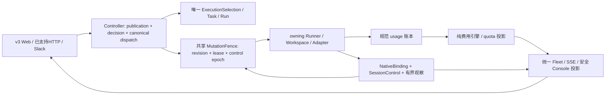
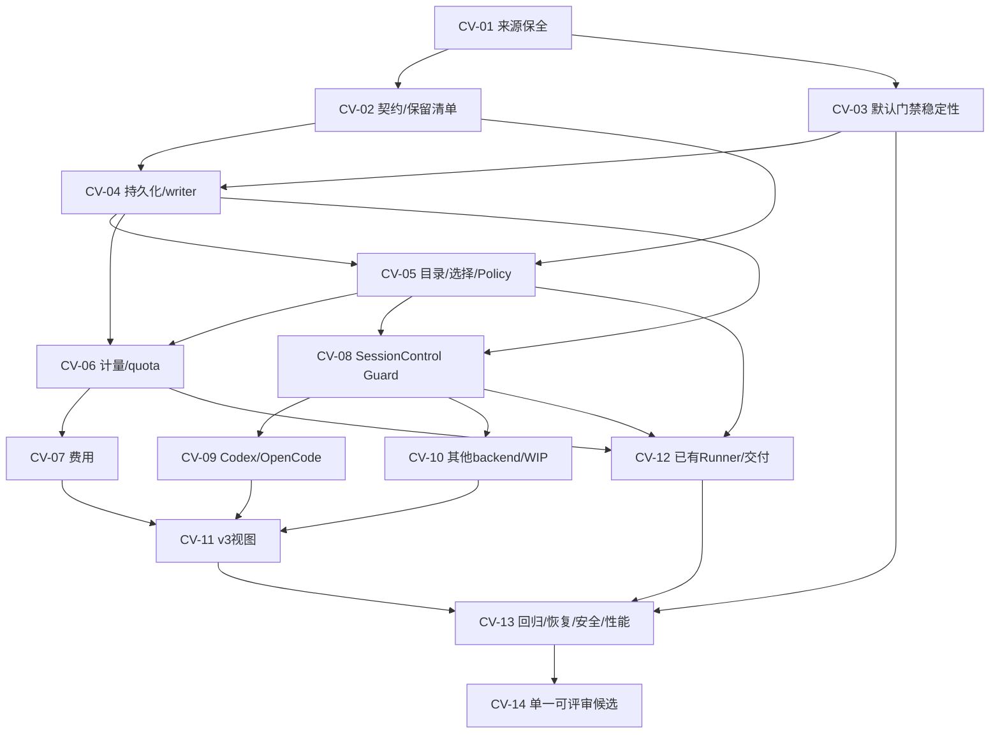

# Dispatcher 候选分支收敛与能力整合：架构决策及执行计划

> 2026-10-24 当前执行说明：按用户最新持续推进指令执行完整开发范围；下方历史配额停止线不再控制当前执行。每单元仍读取实时额度并保留失败与来源证据，不自动使用reset credits。工程开发与原真实Gate分别验收；CV-14保留全分支审查及单一候选交接。

> 2026-10-20 执行更新：用户已批准实施本计划，macOS 单人优先，分 A 本地日用试用版与 B 完整个人版。A 使用用户级 launchd、浏览器和一个真实 Codex；B 包含费用、Codex/OpenCode 原生往返与原日常/外部/恢复 Gate。依次执行 CV-01→CV-02/03→CV-04→CV-05/06/08/12→macOS 日用化→CV-07/09/10/11→CV-13/14。原验收不弱化，原 Done 不重开。仅增补 Controller 后台服务日用化差距卡。无法解决的问题/测试写入 `docs/convergence-remaining-issues.md` 并继续独立单元；每单元检查额度，剩余 ≤10% 停止。实际进展见 `docs/evidence/convergence/README.md`；以下 2026-10-19 内容保留为原规划快照。

日期：2026-10-19；时区 America/Los_Angeles。状态：**规划，尚未启动产品整合**。用户已授权制定计划和同步Linear；本轮不切分支、不创建整合worktree、不合并/cherry-pick、不备份/迁移实际数据库、不运行付费模型或原生账号操作，不改变原业务票的完成状态。以下“迁入”“运行”“验收”均为后续执行要求。

[上一轮进度审计](docs/progress-audit-2026-10-19.md)；[Linear审计08](https://linear.app/inhandy/document/b66f0eef5308)。本文及新建CV工作项记录本次整合差额，原功能票、Done、证据与正式Gate继续是各能力的记录；不另建第二套产品路线。

## 1. 目标、交付范围与保留原则

交付一个以v3为底座、具有完整来源与等价回归的单一候选：保留v3的新Console、原Task补齐/发布、Policy、独立Runner及none/commit/PR交付，接入旧候选已实现的模型/计量/估算、持久原生身份、只读历史及受控交互。已有真实证据按原SHA/backend/版本/账号保留；只在目标候选重新验证后才能升级为当前候选证据。

保留不等于把所有旧模块无条件启用。每项旧成果必须有一种明确归宿：迁入并等价验证；迁入但因原Gate未过保持关闭；保留来源/恢复产物和原issue中的未完差距；有现有实现等价替代证明后收敛重复实现。未经记录与审阅不能删除旧实现/测试/证据，不能用全局“未支持”遮掉已经证明的具体能力。

本次不扩展Team、云端、物理跨设备、新provider能力或新收费服务；保留这些原任务及依赖。对已实现的本机独立Runner做回归属于保留现有能力，不代表解锁受M17.2 Gate约束的新远程/云端工作。原实现中的未知/失败不要求在收敛中伪造完成：未完工程继续归原票，具体差异在迁入清单逐行跟踪。

## 2. 当前基线与事实

| 来源 | 实时核实的提交/工作区 | 独有成果与证据边界 |
| --- | --- | --- |
| main | af00240b6d62999065141ea390df29d6fe4bbd26 | 主线仍是较早版本，不等于任一候选 |
| v3 | 19db456149593c1feadd7ff0faef35f0dc1452dd；同名远端已推送 | 新Console/安全ConfigPlan/credential epoch；publication/Policy；owning Runner/Git交付；80个测试文件 |
| personal-local | 297c32cbda45e317b2f09eee55eb3dda8d5153f6；工作区干净 | 模型/计费数学与非阻塞计量、原生会话第一批基础和证据；93个测试文件 |
| local-continuation | a499d84e88c9f4ff1d01c89cc20304f236fe2bbd；为personal-local的后继 | 在旧候选基础上继续原生读写/历史/控制、writer protection、各backend宿主；144个已提交测试文件 |
| continuation WIP | 6个已跟踪修改+2个未跟踪测试 | service/config/Copilot接线及4份文档；不是a499d84的一部分，未通过当前完整验收，单独保全/审阅 |

- 三者共同基线为a1e80830620c9fe2482b4293d9c79c1d66772cae；personal-local是continuation祖先，不能将两条旧分支整体各搬一遍。
- v3与continuation分别62/124个独有提交。tip-to-tip差异492文件、50727插入/12297删除；这只是变更规模，不是开发量或完成率。
- 相对共同祖先，v3变更184文件，continuation400文件；并集503项：81项双方都改、103项仅v3、319项仅旧候选。并集与tip diff数量不同是因为部分文件tip内容相同，清单不能只由冲突数推导。
- 查询origin同名refs仅返回main与v3；未返回personal-local/local-continuation同名远端refs。不能据此断言其他远端ref均不包含旧提交，但本地独有历史必须先保全再操作。
- 主工作区保留上一轮未提交的v3计划说明与审计报告，不能顺手提交/清理。continuation WIP已核实为service.ts、config/schema.ts及4份文档，加copilot-runtime-service.test.ts、copilot-config.test.ts。
- Linear已重新完整读取两页297票，CV命名前无匹配；存在NS-001/INH-1496集成基线票In Review。新增CV仅覆盖此次跨候选整合差额，以relatedTo复用原票，不重开或替代它们。
- 原NS-001及文档05内PR富文本出现了openkaiwu/Rhiza-Dev链接，与本仓库remote不符。本计划只采用明确的[Arragon/Dispatcher PR5](https://github.com/Arragon/Dispatcher/pull/5)、[PR6](https://github.com/Arragon/Dispatcher/pull/6)、[PR7](https://github.com/Arragon/Dispatcher/pull/7)；这些是待执行阶段刷新base/head/状态的历史评审入口，不从“#5”自动推断仓库。
- schema路线已从源码核实：v3迁移1–3；personal-local增加4/native_session_interaction；continuation增加5/minimum_writer_protocol及连接函数dispatcher_writer_protocol。不是可以互换的数据目录。

## 3. 收敛方式与决策

### D1：v3作为产品整合底座，按能力迁入旧实现

推荐从v3精确SHA建立隔离整合候选，按下面DAG逐项迁入旧能力的最小完整执行路径与独有回归。保留Git来源/原提交映射，不拷贝整个service.ts、App.tsx、schema或lockfile覆盖当前文件。同一能力已由v3更完整实现时保留v3，补入旧边界断言而不复制第二份服务。

备选“以continuation为底座再回填v3”会重新承接新Console、原Task完成、credential epoch、远程owning与Git交付等大量新安全行为，回归面更宽。“整分支直接merge”在492个tip差异文件和同名不兼容契约下无法按行为审阅；编译通过不足以证明契约、数据和权限兼容。本计划选择按能力迁入，只有CV-01来源保护与CV-02契约决策完成后才允许动产品代码。

### D2：保护来源，分离未提交成果

CV-01执行时保全三个tip和WIP，验证恢复；不在本轮创建这些产物。Git bundle/保护refs与私有WIP快照是迁入前置，不包含运行数据库、native home或秘密。源worktree不被其他任务接管。任何WIP/外部状态变化导致来源过期，都必须先重新读取及重建差异，不能继续按旧patch覆盖。

### D3：保留一个事实源，各边界各守职责

domain/protocol仅纯数据与计算；Adapter/Runner拥有provider parser/transport/native进程与物理目录；Controller编排授权/事务；persistence负责唯一性/CAS/writer gate；Web消费投影。ConfigPlan与secret://边界延续。没有新增数据库、SDK、规则框架或依赖；迁入仓库自身实现，不引入第三方代码。原有第三方原生协议/依赖来源与许可证由CV-13继续复核。

## 4. 差异与能力保留矩阵

V=v3@19db456；L=continuation@a499d84（包括personal-local祖先）；W=未提交。

| 能力/冲突 | 保留来源 | 整合处置 / 拟变更 | 依赖 / 验收归属 |
| --- | --- | --- | --- |
| Console、四步Harness、实体表单、安全配置导出 | V | 保留当前入口、叶级patch与private omission；迁入旧计量/历史的行为，不覆盖旧UI整页 | CV-11；原1469/1844 |
| canonical本地创建、NEEDS_SPEC原Task补齐、幂等receipt、none/commit/PR | V；L的旧local API/结果验收 | V publication为唯一新执行链；仅为实际支持的旧消费者保留显式兼容读取/入口映射，不另起Task | CV-02/05/12 |
| 目录/默认模型/新鲜度 | V当前context/credential scope；L目录/价格/能力增量 | 一份normalized catalog，保留新鲜度、账号/项目/Runner作用域和价格证据；不混用revision/version | CV-05；原1465/1468 |
| ExecutionSelection vs RunModelSelection | V执行身份；L价格/原生reasoning语义 | 当前选择权威保留V，按来源解码旧记录；请求、reported与price分别绑定 | CV-02/04/05 |
| task_classifier/Policy/immutable decision | V；L已有语义与故障回归 | 复用V一套router/receipt，补旧独有边界；确认/无匹配/原始输入hash不改变 | CV-05；原1837–1840 |
| UsageObservation vs UsageMeasurement | V decimal-string/standalone；L非阻塞/实际计费时间与quota服务 | 一个账本；legacy转入可追踪、幂等、无静默精度丢失；不同时运行两套采集累计 | CV-06 |
| PricingSnapshot/estimateCost/actual/quota | L；V当前固定unavailable | 复用旧公式/测试，适配精确数值与有效区间；有依据才出estimate，缺失保持不可估算 | CV-07；原1484 |
| 取消/resume/reroute/credential fencing | V较新修复；L SessionControl/command lane | 原V修复保留，控制epoch叠入同一最终准入，不替换lease/currentRun；cancel安全停止单独判权 | CV-08/12 |
| NativeBinding/历史/审批/接管与交还 | L | 先持久身份与Guard，再宿主/只读，最后按实际能力投影开放动作；unknown继续拒写 | CV-04/08/09/11 |
| Codex/OpenCode实例归属和精确会话 | L runtime/port；V catalog/owned-process/remote | 保留backend区别；原生writer/GUI不因fixture通过升级 | CV-09；原1533–1538 |
| Cursor/Pi/Devin/Copilot | L已提交；W单列 | 对已有backend逐个迁入/适配，原未完功能与WIP保留原票；无新云端启用 | CV-10；原1539/1541/1543/1550/1551 |
| owning Runner/协议/工作区与Git delivery | V | 回归保留，规范计量与控制epoch进入已协商命令；远端不能回退Controller本地代跑 | CV-12；原1391/1392 |
| migration4/5与旧binary禁写 | L | 迁入完整schema/afterApply/database-compatibility/连接函数；按实际schema身份处理 | CV-04/13 |
| 旧测试/脚本/benchmark/证据 | V+L | 独有断言逐行迁入映射；旧脚本测试必须纳入目标Vitest include；不把80+93+144相加 | CV-13 |
| README/architecture/know-how/operations | V+L | 实现时按目标事实更新职责/持久约束/操作；本轮只交付计划，不把拟议结构写成已实现 | CV-14 |
| 原已Done/真实Gate | 各自原issue及SHA | 保留全部旧结论和失败；来源迁入不自动使任何Gate通过 | 既有1841/1845/1470/1491/1387/1394等 |

## 5. 数据、API和授权契约

### C1：执行选择与目录

当前V的ExecutionSelection含runnerId、mode、selectionType、nativeParameters、contextFingerprint、configRevision；L的RunModelSelection含context.baseRevision、catalogVersion、reasoning和pricingSnapshot，二者均version1但结构不等价。新Run只存一个规范执行选择；旧Run按确切来源保留原文并映射可证明字段，缺失Runner/账号/native session事实不能按“当前配置”补齐。自动规则胜出后的模型/effort/价格与用户确认一并冻结；reported模型/effort只来自原生观察。

同一路径 `GET /api/agents/profiles/:id/models` 在两边请求/返回已不同：L要求configRevision等并返回ModelCatalogState，V返回AccountModelCatalog。CV-02必须在实施前确定实际受支持caller、显式兼容标识/升级窗口和两份schema；保留V当前默认响应，不能静默换shape，也不能仅按version1或缺字段猜来源。确定不了的入口阻止CV-05该项实施，其他无依赖工作继续。

L已有 `/api/local/tasks`、spec、result、accept和default-model/plans入口。CV-02逐个查调用者与持久收据，支持的消费者接到同一canonical业务链，鉴权/loopback限制保留；没有消费者并有替代证明的入口可在整合审查中退役，原记录仍读得出。禁止为假设兼容保留第二套发布/结果权威。

### C2：计量与费用

新规范事实沿用V的event identity、decimal-string、metric unit/includedIn、scope、period、observedAt/collectedAt，补上经证明的原生billing occurrence与source-origin/legacy映射信息。L的incremental/cumulative映射为delta/snapshot，不把多个scope重叠相加。已识别native event经同一映射只累计一次；无法证明重复关系则输出partial/待核对，不能猜同一或不同。

新数值不经过JavaScript浮点来回写；费用rate/quantity/结果按CV-02冻结的精度与舍入规则计算。旧JSON number只可按已保存数值恢复，不能声称恢复原生原始精度；不安全大数/不明确精度保留原文与诊断，阻断需要精确依据的估算。旧受支持数字API若保留，其兼容投影不得反向覆盖规范存储。

复用L已有per-1k/1M、cache inclusion、final multiplier、条件free、partial/missing basis与evidenced rate intervals。选择冻结的价格快照不被当前目录更新改写；缺真实价格、occurrence归属或账单维度时继续unavailable。actual、estimate、account quota和ResourceSnapshot分别有所有者；不能用余额变化归因Run，不能以新query清除旧resource block。

### C3：持久身份、最低writer协议与回退

以真实canonical Session.id关联NativeBinding和SessionControl，binding唯一键保留产品/region/backend/store/profile/Runner/native session/execution context事实。Task revision、Run generation/lease与control epoch/revision三者同时核验。身份冲突、未绑定旧数据保留只读诊断，不自动迁移为AUTOMATED。

旧schema4/5的name与语义保持；新序号在CV-04确认目标完整迁移集后分配。最低writer协议、数据库兼容检查和dispatcher_writer_protocol连接函数随schema完整迁入；不删除trigger来兼容旧binary。只对独立备份副本做升级/恢复；切回旧版本必须使用与其兼容的数据副本及停写流程，不能对新数据做降schema。

### C4：一条授权链覆盖所有副作用

v3 RunInputReceipt的输入幂等与L NativeCommandReceipt的原生命令受理描述不同事实，不直接按同名状态合并；它们引用同一当前control fence及语义身份。用户/后台启动、输入、resume、steer、审批、interrupt、reroute、verification、commit/push/PR与post-await持久提交均有最终准入。外部发送前先保存intent，失响应保持UNKNOWN，不自动重放。

请求handoff先封住自动写与交付，native quiescence/release证明后才可HUMAN；return核对身份/模型/权限/候选内容并新epoch，然后重新验证。原生队列、后台tool、晚到响应和函数返回均不是物理停写证明。cleanup/cancel可按安全停止权限继续，不能借此授予prompt/交付权。功能关闭、重启、资源恢复不得清除HUMAN/CONFLICT/UNKNOWN。

### C5：原生能力分批开放

read/history、精确continue、approval/interrupt、release/reclaim、GUI/TUI往返分别按provider/backend/installed-version/account/region/store/workspace/evidence tier限定。先保留或迁入已证明只读，再接执行/控制。原OpenCode/Codex first-release要求不变，其他已有backend按自己的证据开放；未通过的原工程或真实Gate不能被CV整合票取代。

### C6：协议与外部计划依赖

保持domain/protocol无I/O，新增wire字段必须版本化并有实际peer capability；不支持即明确拒绝，不能fallback shell或Controller代跑。原INH-1391受INH-1491个人发布Gate约束的关系保留。本计划CV-12只验证已有本机独立Runner能力，使用relatedTo而不把INH-1391/1491设为CV-12的blockedBy，防止把“保留回归”与“新扩展许可”混成循环。新异机/云端实现仍走原DAG。

## 6. 阶段、依赖与退出Gate

| 阶段 | 工作 | 必须满足的退出条件 |
| --- | --- | --- |
| P0 来源与可测基线 | CV-01 → CV-02；CV-03可与02并行 | 来源可恢复；503项保留归属初版齐；契约/消费者/迁移决策冻结；默认全门禁不稳定已定位且有处置 |
| P1 持久化与模型/计量 | CV-04 → CV-05 → CV-06 → CV-07 | schema与旧binary禁写通过；统一选择/账本/价格，旧记录/消费者可读且无重复副作用 |
| P2 控制与provider | CV-08 → CV-09、CV-10 | 所有写入口Guard无遗漏；已提交backend逐项有目标与测试；WIP有明确归宿，未资格动作保持关闭 |
| P3 UI与现有远程/交付 | CV-11、CV-12 | v3入口保留；计量/历史/能力可见；独立Runner与none/commit/PR正负例通过 |
| P4 单一工程候选 | CV-13 → CV-14 | 独有回归/安全/恢复/性能与精确HEAD CI/审查齐；可回退且一个评审入口；原真实Gate全部有后续归属 |
| P5 原正式验收 | 既有LP07/W6/M17.2W5/个人与远程业务Gate | 依原验收逐项收集真实证据；任一required Gate未过不宣称正式发布 |

CV-02完成前，CV-03的诊断可独立进行；CV-08完成后，CV-09/10可独立推进；CV-12可与provider只读/UI整合并行，但共享service/config/schema的实际编辑应串行或先冻结接口。这里描述可并行的依赖关系，不授权启动多个agent或同时改同一文件。

关键路径取决于实际瓶颈，结构上至少有来源→契约→持久化→模型→计量→费用→UI→全回归→候选，以及Guard→provider→UI路径。没有资源/速率证据，本文不设负责人、截止日或工时。

## 7. 可执行任务卡

所有任务均为整合增量，不重建对应原功能。新票创建为Backlog，父工作包CV-00也为Backlog；规划已同步不意味着产品实现开始。跨契约/迁移/并发/安全任务沿用原A审查标准，普通UI映射按原任务要求；本文不指定实际执行模型或自动委派。

### CV-01 · 冻结来源、保全独有提交与未提交增量

- **映射/架构**：M6.1；原票 INH-1496、INH-1539；沿用D1–D3和相应C1–C6。
- **目标/边界**：建立可恢复、可核对且不会覆盖原工作区的整合输入。
- **已确认模块**：git refs / 三个现有worktree；continuation未提交6个已跟踪文件及2个未跟踪测试；docs/evidence/native-sessions/baseline.md（旧候选）。旧候选路径以a499d84读取；WIP不冒充提交内容。新fixture/桥接模块路径由CV-02按现有职责冻结，本文未将建议文件伪装成已有文件。
- **输入/前置**：三个候选SHA、工作区/status、当前remote与本计划。原票为related输入，缺具体契约/产物时记录到本卡，不靠原状态推断已交付。
- **实现步骤**：

1. 记录三个完整SHA、共同祖先、远端refs、原工作区tracked/untracked清单与文件hash；本轮主目录的审计文档改动也单列。
2. 执行阶段先为独有历史创建受保护refs和可验证的本地Git bundle；对未提交代码以私有补丁+未跟踪文件清单另存快照，排除数据库、native home、凭据、构建产物；未知敏感文件先分类。
3. 从19db456创建隔离整合worktree；暂定分支codex/dispatcher-convergence（执行时重查不存在或归属合适后才创建），不得使用或重置其他chat的worktree。

**验收/输出**：

- [ ] 在可丢弃目录可恢复三个已提交tip；WIP每个文件hash匹配，原worktree内容/status不变。
- [ ] 源保护refs/bundle在验证整合完成前不删除；没有git add -A、stash/reset/clean或运行原数据库。
- [ ] 产出来源与归属清单、恢复步骤和源到整合候选的追踪字段；代码快照不上传Linear。

**验证与证据**：Git refs/log/status、bundle verify与恢复后的hash比对；文档/补丁敏感数据检查。 交付target SHA、来源SHA/文件/原票映射、实际命令/退出结果、正负向和恢复证据、未验证能力；本计划中的验证尚未执行。

**失败/停止/回退**：源被外部进程修改、worktree归属不明、备份不完整或敏感数据分类不清时停止迁入；只重做来源快照。

### CV-02 · 冻结跨候选契约映射与逐能力保留决策

- **映射/架构**：M17.1；原票 INH-1496、INH-1464、INH-1472、INH-1473、INH-1498、INH-1499、INH-1501；沿用D1–D3和相应C1–C6。
- **目标/边界**：消除同名v1不同语义的歧义，形成一个持久权威与一份迁入清单。
- **已确认模块**：packages/domain/src/publication.ts; usage.ts; model-routing.ts（v3）；packages/domain/src/models.ts; metering.ts; session-interaction.ts（continuation）；packages/adapters/src/contracts.ts; protocol/src/index.ts（两边）。旧候选路径以a499d84读取；WIP不冒充提交内容。新fixture/桥接模块路径由CV-02按现有职责冻结，本文未将建议文件伪装成已有文件。
- **输入/前置**：CV-01各自产物验收通过。原票为related输入，缺具体契约/产物时记录到本卡，不靠原状态推断已交付。
- **实现步骤**：

1. 每个生产模块、公开入口、持久kind/表、测试和证据填写保留v3/复用旧实现并适配/保留兼容读取/明确待证据四类处理，标明原issue与后续CV负责项。
2. 确定ExecutionSelection为新执行选择权威，旧RunModelSelection仅按真实来源解码；catalog、原生effort、价格与reported字段分离，NativeBinding引用同一执行选择。
3. 选择UsageObservation的精确decimal-string作为新计量权威；固定legacy number转换、舍入/不安全精度与occurredAt/observedAt差异规则，账户scope不伪造Run。
4. 列出现有HTTP/Slack/CLI/Runner/持久数据的支持消费者，冻结必要的显式兼容边界与退出条件；不按version:1自动探测，也不长期双写两套router/ledger。

**验收/输出**：

- [ ] 184/400份从共同祖先变更文件的并集503项均有归属：81同改、103仅v3、319仅continuation；证据/文档/测试与产品代码分类处理。
- [ ] 契约示例覆盖manual/policy/native-default、已执行旧Run、部分usage、零值、精度不明、UNKNOWN、无绑定旧session；不可无损迁移项给只读/拒写策略。
- [ ] 同一Run/Session只有一个当前选择、一个规范计量账本和一个SessionControl；无重复Canonical Task/dispatch。

**验证与证据**：新增建议的contract-parity fixture和schema round-trip；pnpm boundaries、定向domain/config/protocol测试；审阅列出实际source SHA/契约所有者。 交付target SHA、来源SHA/文件/原票映射、实际命令/退出结果、正负向和恢复证据、未验证能力；本计划中的验证尚未执行。

**失败/停止/回退**：映射必须猜模型/账号/会话/价格、改变外部行为或扩大权限时停止该映射，写明拒绝条件与契约决策；不静默兜底。

### CV-03 · 定位默认全门禁的探测与草稿重载不稳定

- **映射/架构**：M6.1；原票 INH-1380、INH-1470、INH-1844；沿用D1–D3和相应C1–C6。
- **目标/边界**：解释并修复已观察到的3项默认并行失败，建立可信的v3起始基线。
- **已确认模块**：apps/controller/test/harnesses.test.ts；packages/adapters/test/native-cli.test.ts; src/native-cli.ts；apps/web/test/pr-publication.test.tsx; src/PublishPage.tsx。旧候选路径以a499d84读取；WIP不冒充提交内容。新fixture/桥接模块路径由CV-02按现有职责冻结，本文未将建议文件伪装成已有文件。
- **输入/前置**：CV-01各自产物验收通过。原票为related输入，缺具体契约/产物时记录到本卡，不靠原状态推断已交付。
- **实现步骤**：

1. 保留默认3失败、40串行target通过、724串行全通过三份日志，分别调查版本子进程启动阶段和reload完成/useEffect/断言时序。
2. 用单变量、可重复的故障控制确定生产问题、测试同步问题或执行环境限制；先给可复现证据，再改最小责任点。
3. 源码bug补回归；若仅测试同步问题，等待产品的实际完成条件而不降低原断言；若环境问题，明确所需资源并证明相同默认命令可通过，不能反复取绿。

**验收/输出**：

- [ ] 两项probe失败和一项reload失败各有因果证据与处置；无未解释失败被改为通过。
- [ ] 原有探测deadline、取消、安全拒绝和草稿冲突语义保留；无skip、增加重试或放宽超时。
- [ ] 修复后默认pnpm check完整通过；串行结果只作为对照。无法达到时保持本票未完成并给准确环境阻塞。

**验证与证据**：pnpm vitest run apps/controller/test/harnesses.test.ts apps/web/test/pr-publication.test.tsx packages/adapters/test/native-cli.test.ts；pnpm check；只在新增证据需要时做串行对照。 交付target SHA、来源SHA/文件/原票映射、实际命令/退出结果、正负向和恢复证据、未验证能力；本计划中的验证尚未执行。

**失败/停止/回退**：无法定位因果时交付诊断证据，不能把默认命令换成串行作为本票完成标准。

### CV-04 · 整合持久化、原生身份与最低写入协议

- **映射/架构**：M17.2；原票 INH-1472、INH-1499、INH-1504、INH-1564、INH-1386；沿用D1–D3和相应C1–C6。
- **目标/边界**：让schema1–3、4、5数据安全进入同一个候选，保留旧二进制禁写与会话唯一性。
- **已确认模块**：packages/persistence/src/index.ts（两边）；packages/persistence/src/interaction-store.ts（旧候选）；packages/persistence/test/interaction-migration.test.ts; native-upgrade-rollback.test.ts（旧候选）；packages/persistence/src/database-compatibility.ts（旧候选）。旧候选路径以a499d84读取；WIP不冒充提交内容。新fixture/桥接模块路径由CV-02按现有职责冻结，本文未将建议文件伪装成已有文件。
- **输入/前置**：CV-02、CV-03各自产物验收通过。原票为related输入，缺具体契约/产物时记录到本卡，不靠原状态推断已交付。
- **实现步骤**：

1. 按迁移name/SQL/afterApply与实际schema语义比较，不只看数字。保留旧4 native_session_interaction与5 minimum_writer_protocol的既有含义；后续新迁移在核实全分支后分配新序号。
2. 迁入binding唯一键、SessionControl CAS、命令semantic hash、observation checkpoint与writer gate；完整注册连接函数，不能仅拷贝触发器。
3. 添加受控source-origin/schema导入步骤：保留原JSON与版本、生成幂等映射；未知绑定/缺失native owner只读，不通过配置默认值补齐。
4. 升级仅用于独立备份副本；禁写、旧binary访问与安全恢复在独立进程证明，原数据库不启动。

**验收/输出**：

- [ ] schema1–3/4/5及中断迁移重复运行均正确；事务失败回滚、重复binding诊断、旧entity/外部evidence保持。
- [ ] 没有支持函数的旧binary无法写入受保护数据；HUMAN/CONFLICT/UNKNOWN在重启与功能关闭后仍拒写。
- [ ] 从只读历史到新绑定必须显式核对；恢复不重复start/input/commit/PR；备份恢复可核对完整性。

**验证与证据**：迁入并保留原persistence migration/upgrade断言，新增跨候选fixture；pnpm vitest run packages/persistence/test；pnpm check。 交付target SHA、来源SHA/文件/原票映射、实际命令/退出结果、正负向和恢复证据、未验证能力；本计划中的验证尚未执行。

**失败/停止/回退**：migration序号碰撞、writer gate被绕过或恢复不可复核时停止该数据路径；使用原备份与兼容binary恢复，不降schema/删控制记录。

### CV-05 · 收敛目录、默认模型、Policy与不可变执行选择

- **映射/架构**：M17.1；原票 INH-1465、INH-1466、INH-1474、INH-1476、INH-1477、INH-1478、INH-1479、INH-1837、INH-1838、INH-1839、INH-1840；沿用D1–D3和相应C1–C6。
- **目标/边界**：保留两边已交付行为，落到v3现有publication/dispatch/decision链。
- **已确认模块**：apps/controller/src/service.ts; model-routing.ts; task-classifier.ts; policy-config.ts（v3）；apps/controller/src/model-catalogs.ts; model-routing-decisions.ts; task-classification.ts（旧候选）；packages/domain/src/publication.ts; model-routing.ts（v3）。旧候选路径以a499d84读取；WIP不冒充提交内容。新fixture/桥接模块路径由CV-02按现有职责冻结，本文未将建议文件伪装成已有文件。
- **输入/前置**：CV-02、CV-04各自产物验收通过。原票为related输入，缺具体契约/产物时记录到本卡，不靠原状态推断已交付。
- **实现步骤**：

1. 以v3 actor/input/config/catalog绑定的publication/decision为唯一新增执行入口；旧catalog scope/价格字段与能力证据适配到此链，不迁入第二个router或新发布页。
2. 保留v3 NEEDS_SPEC原Task补齐、create-only、selected SCM、冻结验证/交付、saved taskTypeId及原始输入hash。
3. 旧default/selection记录和真实旧调用仅经过来源明确的兼容读取；新发布不通过省略字段走legacy默认。
4. 跨本机/owning Runner重新查目录和实际worktree上下文；Effort值来自已验证能力，不靠prompt模拟。

**验收/输出**：

- [ ] 同账号并发不同模型不污染；默认/目录改动和重启不改旧Run；native-default省参不假报实际值。
- [ ] no-match、冲突、价格/权限/上下文漂移、陈旧确认、分类重试/取消均fail closed，双击/失响应/重启不重复分类或启动。
- [ ] HTTP/Slack旧来源、原Task补齐、none/commit/PR与新Policy行为均保留；选定与实际reported证据不混写。

**验证与证据**：保留两边目录/选择/分类/路由独有断言，映射到目标路径；v3 task-publications/policy-config/native-models及scheduler/adapters tests；pnpm check。 交付target SHA、来源SHA/文件/原票映射、实际命令/退出结果、正负向和恢复证据、未验证能力；本计划中的验证尚未执行。

**失败/停止/回退**：不得为适配旧型而退回共享profile改写或复制整个service.ts；有公开合同冲突先更新CV-02决定。

### CV-06 · 整合非阻塞用量与账号周期额度账本

- **映射/架构**：M17.1；原票 INH-1467、INH-1481、INH-1482、INH-1483、INH-1485；沿用D1–D3和相应C1–C6。
- **目标/边界**：一个规范账本同时支持精确观测、旧记录、非阻塞采集和多周期quota。
- **已确认模块**：apps/controller/src/usage-observations.ts; service.ts（v3）；apps/controller/src/metering.ts; packages/domain/src/models.ts（旧候选）；packages/adapters/src/codex.ts; qoder.ts（两边）。旧候选路径以a499d84读取；WIP不冒充提交内容。新fixture/桥接模块路径由CV-02按现有职责冻结，本文未将建议文件伪装成已有文件。
- **输入/前置**：CV-04、CV-05各自产物验收通过。原票为related输入，缺具体契约/产物时记录到本卡，不靠原状态推断已交付。
- **实现步骤**：

1. 复用v3 exact-decimal/event identity、standalone scope与owning Runner缓存；迁入旧Codex/Qoder非阻塞collection、quota只读能力、TTL/last-success语义。
2. 确定event identity与source-origin导入键；同一原生事件从两条旧采集路径到达只计一次，无法证明同源则标待核对，不猜测相加。
3. 保留period/unit/turn/run/session/generation/attempt映射与occurrence时间；旧JSON与原native证据保持可追踪。
4. 采集任务与业务advance解耦，终态持久化失败可重试保存但不新推理；失效数据只影响展示与既有resource判定，不推导余额差为任务成本。

**验收/输出**：

- [ ] delta/cumulative、乱序、缓存包含、snapshot缺维度、零值/缺失、多单位/周期、重放/重启和跨attempt均有断言。
- [ ] ACTIVE读取不await turn.result，不挡取消/lease；UI关闭仍采集；standalone不生成canonical Run。
- [ ] 账户数值未知不补0，quota read失败不将Run判失败；resource block/currentRun与lease仍由原权威处理。

**验证与证据**：保留v3 usage-observations与旧domain/controller metering、nonblocking、quota测试；新增跨来源导入/重放fixture；pnpm check。 交付target SHA、来源SHA/文件/原票映射、实际命令/退出结果、正负向和恢复证据、未验证能力；本计划中的验证尚未执行。

**失败/停止/回退**：无可靠event identity或时间/精度依据的数据保持partial/unknown，只读历史，不启用猜测累计。

### CV-07 · 复用费用引擎并接通精确计费快照

- **映射/架构**：M17.1；原票 INH-1484、INH-1467、INH-1472；沿用D1–D3和相应C1–C6。
- **目标/边界**：恢复已有倍率/分段/缺字段语义，使有有效基准时可估算，缺失时准确解释。
- **已确认模块**：packages/domain/src/metering.ts; models.ts（旧候选）；packages/domain/test/metering.test.ts（旧候选）；apps/controller/src/usage-observations.ts（v3）。旧候选路径以a499d84读取；WIP不冒充提交内容。新fixture/桥接模块路径由CV-02按现有职责冻结，本文未将建议文件伪装成已有文件。
- **输入/前置**：CV-06各自产物验收通过。原票为related输入，缺具体契约/产物时记录到本卡，不靠原状态推断已交付。
- **实现步骤**：

1. 迁入已有estimateCost语义与测试，按CV-02精度契约适配v3 decimal量；可将当前直接相关的decimal纯函数移到domain复用，不引入新收费SDK/规则框架。
2. rate/multiplier/条件free/实际消耗与采集来源分别记录；新估算输出含公式版本、输入IDs、价格快照、区间、舍入与完整性。
3. 旧number接口仅做有来源的兼容投影，保存时不损失新精度；精度/计费基准不足则unavailable，不用静态价格。
4. 按实际billing occurrence切段；仅observedAt不能证明费率生效归属时不强分段。

**验收/输出**：

- [ ] 每1k/1M、cache read/write与input包含、final-rate不重复倍率、条件免费、混合币种/区间重叠/部分维度/大数精度均有正反例。
- [ ] actual和estimate可并存，不修改quota/resource；无有效价格/账单事实仍明确不可估算。
- [ ] 已有纯数学断言保留语义；新增精度边界与legacy/v3输入同口径等价证明。

**验证与证据**：迁入domain metering tests、Controller integration tests及新增decimal/跨候选fixture；pnpm check。 交付target SHA、来源SHA/文件/原票映射、实际命令/退出结果、正负向和恢复证据、未验证能力；本计划中的验证尚未执行。

**失败/停止/回退**：无法证明计费单位、精度或区间时保留unavailable；不通过价格猜测使界面产生数字。

### CV-08 · 将SessionControl统一接入所有写入与交付入口

- **映射/架构**：M17.2；原票 INH-1514、INH-1515、INH-1516、INH-1517、INH-1518、INH-1519、INH-1520、INH-1521、INH-1522；沿用D1–D3和相应C1–C6。
- **目标/边界**：保留v3取消/resume/reroute修复，同时迁入一个SessionControl/MutationFence，不产生双重控制权威。
- **已确认模块**：apps/controller/src/native-interactions.ts; native-external-changes.ts; native-delivery-candidates.ts（旧候选）；apps/controller/src/run-inputs.ts; service.ts（v3）；packages/domain/src/session-interaction.ts（旧候选）。旧候选路径以a499d84读取；WIP不冒充提交内容。新fixture/桥接模块路径由CV-02按现有职责冻结，本文未将建议文件伪装成已有文件。
- **输入/前置**：CV-04、CV-05各自产物验收通过。原票为related输入，缺具体契约/产物时记录到本卡，不靠原状态推断已交付。
- **实现步骤**：

1. 迁入旧控制状态/epoch、CAS、command lane、observation fence和approval桥；在v3现有Run input/publication/SCM收据中绑定同一control epoch，保持各receipt实际用途。
2. 逐入口审计HTTP、Slack、semantic、后台resource/advance、Scheduler、native队列、verification、commit/push/PR及post-await提交；每项标明授权与最终准入位置。
3. cancel安全停止权限与写prompt/交付权限分开；retain v3先撤权再等待physical drain、unknown占用和reroute ownership transfer。
4. human-return的模型/账号/权限/候选内容漂移使旧验证失效；无native release/attach证明时不授予自动控制。

**验收/输出**：

- [ ] HUMAN/HANDOFF_REQUESTED/RECONCILING/CONFLICT及缺失可靠绑定状态下，所有写入口无绕过；只读保留。
- [ ] cancel与resume/reroute/后台恢复竞态、lost ACK、double command、迟到native响应、重启/功能关闭均保持旧authority与UNKNOWN。
- [ ] 同一原生session无新旧writer并行；不能用root exit/HTTP accepted作为释放证据。

**验证与证据**：迁入interaction-guard、native-command-receipt、native-reclaim、handoff、delivery-fence/chaos测试；保留v3personal-loop/run-inputs/remote-execution回归；pnpm check。 交付target SHA、来源SHA/文件/原票映射、实际命令/退出结果、正负向和恢复证据、未验证能力；本计划中的验证尚未执行。

**失败/停止/回退**：发现有遗漏写入口或旧writer无法隔离则禁止启用对应交互能力；不能先开放UI再补Guard。

### CV-09 · 迁入Codex/OpenCode宿主与只读原生会话能力

- **映射/架构**：M17.2；原票 INH-1533、INH-1534、INH-1535、INH-1536、INH-1537、INH-1538、INH-1507、INH-1508、INH-1490；沿用D1–D3和相应C1–C6。
- **目标/边界**：将旧宿主/精确身份/分页观察接入v3，保留当前catalog、process ownership和managed scope。
- **已确认模块**：apps/controller/src/codex-runtime.ts; opencode-runtime.ts; native-history.ts（旧候选）；packages/adapters/src/codex-app-server.ts; opencode-server.ts（旧候选）；packages/adapters/src/native-profile.ts; owned-process.ts（v3）。旧候选路径以a499d84读取；WIP不冒充提交内容。新fixture/桥接模块路径由CV-02按现有职责冻结，本文未将建议文件伪装成已有文件。
- **输入/前置**：CV-08各自产物验收通过。原票为related输入，缺具体契约/产物时记录到本卡，不靠原状态推断已交付。
- **实现步骤**：

1. 复用旧provider连接、cursor/历史、requestSink、factory producer和运行scope，不重写协议客户端或靠UI传原始payload。
2. 对同provider的exec/app-server/server等backend保留明确身份；每个binding固定home/store/Runner/worktree/native ID。
3. 优先迁入观察/历史，随后仅按已验证tuple开放精确continue/approval；release/reclaim/UI能力按原NS真实Gate单列。
4. 保持有界历史/取消上下文/连接drain与晚到响应拒绝；capability evidence版本/账号/存储/上下文失效不可沿用旧READY。

**验收/输出**：

- [ ] exact ID/账号/存储域/工作区不匹配、schema不兼容、分页缺口/超时、服务复用漂移均明确拒绝。
- [ ] 旧有只读和执行回归迁入并通过，不把unqualified release/GUI自动标supported；操作不创建替代session。
- [ ] v3 Codex usage/独立Runner/native child清理不退化；OpenCode unknown/release缺证据仍显式关闭。

**验证与证据**：迁入Codex/OpenCode runtime/client/interaction tests；当前catalog/process/profile回归；pnpm check；真实版本/账号往返仍由INH-1535/1538等原Gate负责。 交付target SHA、来源SHA/文件/原票映射、实际命令/退出结果、正负向和恢复证据、未验证能力；本计划中的验证尚未执行。

**失败/停止/回退**：动态共享服务归属或原生writer停止无法证实时，保留观察与历史并关闭控制转移；不杀共享服务。

本地增量证据（2026-10-23）：Codex canonical backend/host、ConfigPlan/catalog、
Controller exact-source/启动审批/全宿主关闭及原native-history reader/API已通过
179文件/2103例默认检查；保留59个旧service用例组与27个旧reader用例，另有
31个service和4个reader回归，独立审查修复后无遗留代码问题。历史读取严格有界，
实际I/O前复核授权，不持久化transcript；时间戳也经过敏感元数据校验。
重启仅对一致绑定元数据作UNKNOWN/manual对账，部分或冲突记录保持启动保护，
不重连、不重放，也不把本地root关闭当作writer释放。OpenCode及原真实环境Gates
仍未完成，因此本卡验收框和Linear状态继续保持未完成。

OpenCode server后端已保存5698afa：保留145个原始用例并新增32个原始上下文/
异步持久化/project/审批回归；默认183文件/2280例和非测试门禁通过，独立
spec/quality审查无遗留问题。当前仅内部后端及standalone只读注入，未激活
server profile。owned host/producer及精确分配observer随后保存105ef8b与修复a009626，
保留原20+20例，当前host23/producer82/shared observer66；完整185文件/2424例
与非测试门禁通过，独立复审关闭3项输入兼容问题。清理未知、pending-create和
持久化失败继续保守处理。canonical catalog0208bff随后通过独立审查，31项来源安全
断言映射为当前AccountModelCatalog/immutable selection，新增71例，最终186文件/
2495例和非测试门禁通过；实际backend、读取前捕获与清理后复核已补齐。
内部runtime随后保存761dddd：保留12原始用例并新增99回归，host既有23例外再补两处actual-spawn守卫；最终默认187文件/2608例及非测试门禁通过。独立spec/quality审查通过，无Critical/Important，21个Git输入与16个生成输入均匹配最终manifest。下一ConfigPlan/factory注册按preflight合为原子单元，避免schema单独放行后误落standalone；原子注册随后保存394a33d并独立审查通过：最终focused2/94与默认188文件/2695例通过，四份Git payload精确匹配；结构schema无物理I/O，禁用profile不调用工厂，server必须精确owning backend且显式opt-in。Controller C1随后保存809c315与修复bc3e252：原S1-S5接入精确启动/source，post-source回调后再次核对Controller owner；聚焦334、默认189文件/2758例通过，独立fix round1关闭I1无新增阻断。C2随后保存db9744e并独立审查通过：S6-S8、raw profile/SQLite barrier及三runtime错误聚合，focused5/239、默认189/2787通过；原Pi接口保留，首轮历史快照lint污染及引入的Pi接口失败均留证，42712份证据迁移字节一致。C3随后保存c82af5c并独立审查通过：显式OpenCode只读重启证书、86腐坏矩阵+5正向，focused5/318及默认189/2878；四个Git输入与最终manifest精确匹配，原canonical Task恢复与未知能力保留。继续Pi三单元差距计划、native ownership prerequisite及其他provider/UI/retention/delivery，原真实Gates保持；未激活真实profile/账号/服务。

### CV-10 · 保留其他本地Harness增量与Copilot未提交工作

- **映射/架构**：M17.2；原票 INH-1539、INH-1541、INH-1543、INH-1551、INH-1550、INH-1468；沿用D1–D3和相应C1–C6。
- **目标/边界**：让已有backend成果可追溯地迁入或保持明确的未启用状态，保留未完工程，避免遗漏。
- **已确认模块**：旧Copilot/Pi/Devin/当前Cursor适配器与Controller runtime；apps/controller/test/copilot-runtime-service.test.ts; packages/config/test/copilot-config.test.ts（未提交）；packages/adapters/src/contracts.ts; native-profile.ts（目标）。旧候选路径以a499d84读取；WIP不冒充提交内容。新fixture/桥接模块路径由CV-02按现有职责冻结，本文未将建议文件伪装成已有文件。
- **输入/前置**：CV-08各自产物验收通过。原票为related输入，缺具体契约/产物时记录到本卡，不靠原状态推断已交付。
- **实现步骤**：

1. 按backend/版本/来源将Cursor local、Pi RPC、Devin local ACP、Devin v3、Copilot逐项分清，复用旧client/producer/runtime；不因同provider合并路径或把云端能力启用。
2. 先迁入已提交可测模块；Copilot六个tracked加两个untracked WIP作为独立增量审阅，保留历史失败，不能自动进入发布集合。
3. 缺ConfigPlan/service/qualified-command实现继续归原issue，只整合已存在行为及必要适配；接入实际controller和manifest，不能只保留死代码。
4. 每个backend产出迁入测试清单/当前启用条件/原始待完差距，未验证的catalog、pricing、GUI和writer能力保持unknown。

**验收/输出**：

- [ ] 每个已有模块/测试/证据都有明确目标或经审阅的暂留原因；没有无记录丢失、删除或被generic壳替代。
- [ ] 同会话恢复不存在时拒绝创建替代会话；producer scope/physical home/store、ACK/settled/owned cleanup等旧断言保留。
- [ ] WIP只有针对性和完整目标检查均通过才可提交/启用；否则继续在原NS-044下明确未完成，不阻挡其他合格backend的集成。

**验证与证据**：按每个backend迁入旧client/runtime/service测试；对受支持启用路径运行目标pnpm check；WIP历史失败仅作输入，需独立当前结果。 交付target SHA、来源SHA/文件/原票映射、实际命令/退出结果、正负向和恢复证据、未验证能力；本计划中的验证尚未执行。

**失败/停止/回退**：若迁入要求新云端/付费/原生登录或修复原计划外功能，记录到原票并保持该backend关闭；不扩大范围。

**2026-10-24 当前工程回执**：Pi Task1保存76b7839，测试/fixture限定增量恢复G1/G3/G4/G5与无dispatch配置重启，新增15service例；7文件/196聚焦及默认189文件/2893例通过，独立spec/quality Approved无Critical/Important。三个Git输入及真实pre/post证据匹配；Task2 raw工作寿命和Task3 bound只读重启继续，不升级native读取/工具/自动推进资格。其他backend与CopilotWIP仍依后续单元，CV-10未完成。

### CV-11 · 将计量与原生会话视图接入v3现有交互

- **映射/架构**：M17.2；原票 INH-1469、INH-1485、INH-1525、INH-1526、INH-1527、INH-1528、INH-1529、INH-1530、INH-1844；沿用D1–D3和相应C1–C6。
- **目标/边界**：沿v3布局与canonical Task页面复用旧计量/历史/控制视图的行为，保留安全投影。
- **已确认模块**：apps/web/src/UsagePanel.tsx; PublishPage.tsx; TaskDetail.tsx; AgentsPage.tsx（v3）；MeteringView.tsx; NativeSessionPanel.tsx; NativeHistory.tsx; HandoffDialog.tsx（旧候选）；apps/controller/src/console-projection.ts; profile-interaction-view.ts（两边）。旧候选路径以a499d84读取；WIP不冒充提交内容。新fixture/桥接模块路径由CV-02按现有职责冻结，本文未将建议文件伪装成已有文件。
- **输入/前置**：CV-07、CV-09、CV-10各自产物验收通过。原票为related输入，缺具体契约/产物时记录到本卡，不靠原状态推断已交付。
- **实现步骤**：

1. 现有发布页/TaskDetail/账号详情加入价格与用量/只读历史/能力说明，不复制旧App/TasksPage或新增平行入口。
2. 仅服务器返回的action flags/evidence决定控制按钮，unknown与disabled给原因；handoff/interrupt/cancel的实际含义区分。
3. 保留v3分Task草稿、冲突重载、NEEDS_SPEC原Task补齐、四步Harness、entity leaf ConfigPlan、安全export/private omission和上下文链接。
4. SSE snapshot/cursor重建只刷新规范投影；quota/estimate/actual/source freshness与scope均清楚，历史正文不广播至全局事件。

**验收/输出**：

- [ ] 桌面/390px窄屏下能查看实际scope与未知原因、只读历史分页；缓存失败不把旧数据显示为新成功。
- [ ] 未授权/陈旧revision/control epoch/无qualified capability不产生写动作；UI不调用provider原始API。
- [ ] v3既有草稿/配置/凭据保护与旧计量/原生UI独有断言均保留；Slack旧回复来源和代际校验不回归。

**验证与证据**：合并既有web测试行为而非简单计数；API auth/console projection tests；桌面与390px受控浏览器截图/动作证据；pnpm check。 交付target SHA、来源SHA/文件/原票映射、实际命令/退出结果、正负向和恢复证据、未验证能力；本计划中的验证尚未执行。

**失败/停止/回退**：服务端Guard/契约未落地时只展示已允许只读能力；不得让前端推导控制权或绕过公开边界。

### CV-12 · 验证整合后owning Runner与none/commit/PR交付不退化

- **映射/架构**：M6.1；原票 INH-1391、INH-1392、INH-1382、INH-1383、INH-1843、INH-1514；沿用D1–D3和相应C1–C6。
- **目标/边界**：为已经实现的本机独立Runner与交付链补跨能力整合回归，保持已证明能力。
- **已确认模块**：packages/runner/src/native-runtime.ts; local-git-delivery.ts; packages/protocol/src/native-execution.ts（v3）；apps/controller/src/remote-adapter.ts; remote-results.ts; service.ts（v3）；旧native-delivery-candidates/native-interactions guard。旧候选路径以a499d84读取；WIP不冒充提交内容。新fixture/桥接模块路径由CV-02按现有职责冻结，本文未将建议文件伪装成已有文件。
- **输入/前置**：CV-05、CV-06、CV-08各自产物验收通过。原票为related输入，缺具体契约/产物时记录到本卡，不靠原状态推断已交付。
- **实现步骤**：

1. 将选择/计量/SessionControl的规范数据放入既有versioned/capability-negotiated命令；旧peer只按实际兼容能力处理，不能在Controller本地代跑远程请求。
2. 保持owner Runtime进行仓库/模型查询、worktree、native start/continue、verify/result与Git mutation；不通过引入Native Session绕开原Runner租约。
3. 把新control epoch guard覆盖到既有commit/push/PR durable receipts与frozen SCM选择；已成功push/未知PR结果分别保留。
4. 用独立进程和隔离bare Git/受控SCM验证已有范围；本票不启动新物理设备部署或云端交互扩展。

**验收/输出**：

- [ ] Controller-zero-local native/Git负向断言、旧generation/撤权/断线重连/重启/unknown start/input/PR均通过。
- [ ] none仍COMPLETE/REVIEW且无SCM副作用；commit不push；PR只投明确冻结目标，lost ACK不重复提交。
- [ ] HUMAN/UNKNOWN禁止验证/交付；取消等待owning Git/native组drain，旧Run不能写新owner结果。

**验证与证据**：remote-execution、remote-results、native-runtime、local-git-delivery、explicit-pr-delivery与personal-loop tests；独立进程证据；pnpm check。 交付target SHA、来源SHA/文件/原票映射、实际命令/退出结果、正负向和恢复证据、未验证能力；本计划中的验证尚未执行。

**失败/停止/回退**：能力协商或owner上下文不一致时拒绝，不回退Controller本地执行；异机/真实PR Gate继续由原票负责。

### CV-13 · 完成跨候选回归、安全、恢复与性能证据

- **映射/架构**：M6.1；原票 INH-1386、INH-1470、INH-1558、INH-1562、INH-1563、INH-1564；沿用D1–D3和相应C1–C6。
- **目标/边界**：证明保留的是行为和边界，而非仅合并文件或凑测试总数。
- **已确认模块**：两边现有tests、scripts/test/native-evidence.test.ts（旧候选）；benchmarks/metering.mjs; native-interactions.mjs（旧候选）；docs/dependencies.md; docs/operations.md。旧候选路径以a499d84读取；WIP不冒充提交内容。新fixture/桥接模块路径由CV-02按现有职责冻结，本文未将建议文件伪装成已有文件。
- **输入/前置**：CV-03、CV-11、CV-12各自产物验收通过。原票为related输入，缺具体契约/产物时记录到本卡，不靠原状态推断已交付。
- **实现步骤**：

1. 建立原80/93/144测试文件到目标断言的映射；相同断言可归并，独有正反例不得丢失，测试文件数不可相加作为验收。
2. 在独立数据目录跑旧fixture、新schema、功能关闭、控制状态与恢复fault matrix；unknown external effect不能由旧备份自动重放。
3. 审计secret/private path/export/事件/历史边界、原生协议来源与已有依赖license；本计划不引入新库，发现新增则先走既有license gate。
4. 跑已有根门禁与必要metering/native-history负载、idle/RSS/CPU测量；阈值沿用原票与架构目标，不虚构新的数字或把smoke当长期通过。
5. 迁入旧scripts/test/native-evidence.test.ts的有效断言，并使目标Vitest显式发现它；当前v3 include不含scripts/test，旧include包含该目录，不能让合并后的测试静默消失。

**验收/输出**：

- [ ] 目标默认pnpm check在同一精确SHA完整通过；所有独有原断言有目标位置/可复核替代，未改skip/超时/安全约束。
- [ ] 1k active/10k history相关负载、非阻塞计量、历史有界性按原任务出测量报告；CPU/RSS目标若未达如实保留未通过。
- [ ] 升级失败原子、旧binary禁写、备份恢复后无重复外部写、feature off保留HUMAN/UNKNOWN、取消owned descendant全部有证据。

**验证与证据**：pnpm check；pnpm benchmark -- --scenario smoke --duration 5；旧metering/native-interactions benchmark在CV-02确认脚本适配后运行，准确参数由脚本配置读取；相应security/upgrade tests。 交付target SHA、来源SHA/文件/原票映射、实际命令/退出结果、正负向和恢复证据、未验证能力；本计划中的验证尚未执行。

**失败/停止/回退**：required测试/恢复/安全失败，或原断言无法找到等价目标时本票不关闭；不通过删除历史或放松检查达标。

### CV-14 · 形成单一可评审候选及逐能力Gate交接

- **映射/架构**：M6.1；原票 INH-1496、INH-1470、INH-1491、INH-1565、INH-1845、INH-1387、INH-1394；沿用D1–D3和相应C1–C6。
- **目标/边界**：交付一个可复核、可回退的整合候选，保持工程整合与正式发布范围分开。
- **已确认模块**：候选分支/PR与来源清单；docs/architecture.md; know-how.md; operations.md；原有capability matrix与pending-human-confirmations（迁入后的原位置）。旧候选路径以a499d84读取；WIP不冒充提交内容。新fixture/桥接模块路径由CV-02按现有职责冻结，本文未将建议文件伪装成已有文件。
- **输入/前置**：CV-13各自产物验收通过。原票为related输入，缺具体契约/产物时记录到本卡，不靠原状态推断已交付。
- **实现步骤**：

1. 在所有迁入波次完成后对整条diff独立审查，修复阻断问题并重验受影响行为；未经授权不自动merge。
2. 确认target相对main及旧PR5→6→7的包含关系；在候选明确时采用一个最终主线评审入口，旧PR保留历史并按实际supersede关系安排，不能分别merge重复堆叠。
3. 交付冻结SHA、来源映射、测试/CI、支持能力、默认关闭能力、数据兼容和回退步骤；main合入后再读回HEAD和CI，不以branch push代替集成。
4. 工程候选的完成不关闭原真实Gate：目录、tuple/计费、writer roundtrip、生产service/keyring、Slack外部链/备份/物理异机继续在原票逐项验收。

**验收/输出**：

- [ ] 所有迁入范围行均有已验证目标，或经明确审阅的保留/暂缓项及原issue；无无主丢失能力。
- [ ] 精确candidate SHA默认门禁与适用CI通过；CI不可读或未运行则不称可合并，保留明确阻塞。
- [ ] 只有一个交付候选/主线评审入口；原分支、bundle、dirty保护和历史证据未提前删除；原Gate及依赖未被改成Done。

**验证与证据**：完整diff审查、来源/测试/Gate映射检查、精确HEAD pnpm check与CI readback、回退演练记录；PR附件按创建工具要求关联。 交付target SHA、来源SHA/文件/原票映射、实际命令/退出结果、正负向和恢复证据、未验证能力；本计划中的验证尚未执行。

**失败/停止/回退**：CI/审查/恢复/来源保全任一required项未通过，不merge、不清理源。真实环境未授权的动作留待原Gate执行。

## 8. 不重复建票与原Gate交接

| 原责任 | 本次CV差额 | 原票退出条件继续保留 |
| --- | --- | --- |
| NS-001/1496基线与差异 | CV-01/02补此次三候选、WIP、同名契约/PR仓库校正 | 原状态In Review保持，CV不能替代正式基线审查 |
| M17.1 W0/W1/W2/W7 | CV-02/04/05跨候选contract/consumer适配 | 原目录/选择/规则/分类契约、负向条件和逐tuple证据不删 |
| W3/1481–1485 | CV-06/07整合已实现非阻塞/decimal/估算 | 不新建“从零开发费用引擎”，原计费有效性验收保留 |
| NS-009/019与control core | CV-04/08接入v3新路径 | CAS/epoch/未知状态/所有副作用Guard标准不降 |
| NS-038..056各backend | CV-09/10迁入已存在代码与测试 | 未完命令/登录/GUI/writer资格仍归各原票，不默认延到人工 |
| LP-01/LP-07/W6：1841/1845/1470 | CV-11/13准备统一候选和回归 | 系统目录成功/取消/中文空格、关闭网页、问答/取消/失败、接受和重启仍需真实场景 |
| M17.2W5/1491：NS-063..070 | CV-13/14交付工程/证据映射 | OpenCode+Codex精确身份、人机往返、writer证明、升级回退/安全/性能/真实Slack链继续阻断正式发布 |
| M6.1：1386/1387/1390 | CV-04/13复用恢复和诊断基线 | 真实备份恢复与Slack→Linear→Codex→GitHub/CI/Slack、日常资源证据仍依原票 |
| M12.1：1391/1392/1394 | CV-12只保留已实现owning执行 | 异机/真实PR-CI-Linear和OS故障矩阵未因本机独立进程通过而关闭 |
| Team/云端/RHIZA/M19 | 无新增实施 | 原启动依赖/默认关闭与证据门槛保留 |

执行时“已实现但待整合”的成果只补适配与回归；“已迁入但能力未资格”的模块保持明确关闭；“原来未实现”的要求不在CV票暗中扩为从零实现。所有Gate明确列出工程缺口、验证缺口、具体外部条件，不能将全部In Review转为等待用户。

## 9. 验证命令、证据和本轮规划验证

命令来自当前AGENTS.md/package.json：`pnpm build`、`pnpm typecheck`、`pnpm lint`、`pnpm boundaries`、`pnpm vitest run <实际测试文件>`、`pnpm check`、`pnpm benchmark -- --scenario smoke --duration 5`。Node/pnpm按mise.toml（24.21.0/11.19.0）。需要旧脚本的精确参数在迁入时从脚本配置推导，未确定前不编造命令。各波次按影响范围跑定向检查；根共享契约/迁移/authority波次完成后跑完整默认门禁。不得把串行替换默认门禁作为稳定性修复。

上一轮同一会话、同一产品HEAD：默认pnpm check 721通过/3失败，原3文件串行40通过，完整串行80文件/724通过。这是CV-03的输入证据，不是本轮新整合的通过记录。continuation a499d84的2588测试记录和WIP失败是历史台账，未在本轮重跑，不把新旧总数相加。

本轮只核对refs/status、源码契约/迁移/调用链、完整297票元数据及关键票依赖；检查新DAG无缺失/自依赖/环，核对每个原票ID存在；新CV票使用实际id读回验证blockedBy，保留全部原票状态。文档变动执行git diff --check；未改产品代码/测试/数据库/依赖/权限，未运行生产服务或外部探针。

完整证据应包括：candidate SHA、来源commit/WIP哈希、模块/原issue/目标断言映射、测试命令和原始失败/修复后结果、schema/恢复前后摘要、native tuple/实际进程和Run/Session身份（只在对应真实验收中）、可回退步骤与未通过Gate。秘密、私有home内容、raw凭据和敏感补丁不进入Linear。

## 10. 执行前必须解决的问题与处理分支

1. **实际旧消费者与同路径/models响应**：CV-02查真实调用/收据后冻结显式兼容协议。若无支持消费者，可退役重复入口但保留旧数据读取；若存在，则单一service提供有限兼容DTO及升级窗口。未定阻止相关入口整合。
2. **旧记录来源和precision**：schema相同不能证明JSON来源；无来源标识的样本通过已知完整结构/实体位置作严格schema鉴别，冲突/缺字段保持只读，不猜。legacy数值精度不明则不参加精确估算，保留原始证据。
3. **Copilot WIP能否迁入**：CV-01保全后在隔离候选审查/复验；通过则以独立迁入提交纳入，否则在NS-044留明确代码/失败/恢复清单，不能丢弃或误标已启用。
4. **原生writer资格**：无法证明release/reclaim的tuple可继续只读/历史与工程回归，不能开放人机写入转换；原NS-040/043等Gate负责真实验收。
5. **PR堆叠与当前CI**：CV-14读实际base/head包含关系再确定单一PR入口和旧PR处置；不会在本次计划中关闭或merge旧PR。CI不可用时只交付候选与阻塞，不能声称主线集成。
6. **范围改变**：需要新公开合同、persisted格式改变或新权限时，本计划已经将这些作为CV-02/04明确决策与审查项；未包含的新边界需先报告，不临时绕过。实际部署/外部业务目标另依原Gate授权，不在本轮执行。

## 11. Linear同步规则

创建一个CV-00整合工作包及CV-01..14增量任务，归入项目现有M6.1/M17.1/M17.2对应里程碑。父包放M6.1；子任务依本节卡片分配。新票全Backlog，无负责人/日期/工时。blockedBy只写新CV DAG；原票用relatedTo与文档映射，避免既有Gate关系被倒挂或形成循环。既有原票status/parent/blockedBy/证据不改。

保存本计划为Linear项目文档09，CV issue正文保存相同任务卡；项目状态更新指向文档09，审计08保持历史快照并加后续计划链接，不重写历史数据。创建结果不明先按CV稳定ID和标题查询，不重复创建。每张票读回id/state/project/milestone/parent/blockedBy/relatedTo；项目再完整分页核对：只新增计划票，原297张状态保持。同步回执附于文末。

## 12. Linear同步回执

- [计划文档09](https://linear.app/inhandy/document/09-候选分支收敛与能力整合计划2026-10-19-0644ca53c45e)已保存为同一项目文档，正文仅一份，14张完整任务卡和11个原章节均已读回。
- [父工作包CV-00 / INH-1917](https://linear.app/inhandy/issue/INH-1917/cv-00-候选分支收敛与既有能力整合)及以下14子任务均为Backlog；23条blockedBy、14个parent关系、项目/里程碑与原票relatedTo逐票读回。
- 项目概览、3个里程碑、4条原票进展评论与[项目状态更新](https://linear.app/inhandy/project/agent-dispatcher-98b768613d26/activity#project-update-b12dcbc3)已写入；审计08仅追加本计划链接，保留原审计时点。
- 完整分页回读312张唯一issue，hasNextPage=false；原297张状态/parent不变，只新增15张计划票。当前Done108 / In Review62 / In Progress37 / Backlog102 / Duplicate3，票数不折算成产品完成率。
- 新DAG14节点、23边，无缺失、自依赖或环；既有原票blockedBy未修改。未设置负责人、日期、工时。
- 本轮新增本地计划文件，未提交或推送；没有产品代码/测试/依赖/数据库/凭据改动，没有创建整合worktree、merge/cherry-pick或运行真实外部验收。

| 规划ID | Linear | 里程碑 | 前置 |
| --- | --- | --- | --- |
| CV-00 | [INH-1917](https://linear.app/inhandy/issue/INH-1917/cv-00-候选分支收敛与既有能力整合) | M6.1 | 汇总子任务，不反向blockedBy |
| CV-01 | [INH-1918](https://linear.app/inhandy/issue/INH-1918/cv-01-冻结来源保全独有提交与未提交增量) | M6.1 | 无 |
| CV-02 | [INH-1919](https://linear.app/inhandy/issue/INH-1919/cv-02-冻结跨候选契约映射与逐能力保留决策) | M17.1 | INH-1918 |
| CV-03 | [INH-1920](https://linear.app/inhandy/issue/INH-1920/cv-03-定位默认全门禁的探测与草稿重载不稳定) | M6.1 | INH-1918 |
| CV-04 | [INH-1921](https://linear.app/inhandy/issue/INH-1921/cv-04-整合持久化原生身份与最低写入协议) | M17.2 | INH-1919、INH-1920 |
| CV-05 | [INH-1922](https://linear.app/inhandy/issue/INH-1922/cv-05-收敛目录默认模型policy与不可变执行选择) | M17.1 | INH-1919、INH-1921 |
| CV-06 | [INH-1923](https://linear.app/inhandy/issue/INH-1923/cv-06-整合非阻塞用量与账号周期额度账本) | M17.1 | INH-1921、INH-1922 |
| CV-07 | [INH-1924](https://linear.app/inhandy/issue/INH-1924/cv-07-复用费用引擎并接通精确计费快照) | M17.1 | INH-1923 |
| CV-08 | [INH-1925](https://linear.app/inhandy/issue/INH-1925/cv-08-将sessioncontrol统一接入所有写入与交付入口) | M17.2 | INH-1921、INH-1922 |
| CV-09 | [INH-1926](https://linear.app/inhandy/issue/INH-1926/cv-09-迁入codexopencode宿主与只读原生会话能力) | M17.2 | INH-1925 |
| CV-10 | [INH-1927](https://linear.app/inhandy/issue/INH-1927/cv-10-保留其他本地harness增量与copilot未提交工作) | M17.2 | INH-1925 |
| CV-11 | [INH-1928](https://linear.app/inhandy/issue/INH-1928/cv-11-将计量与原生会话视图接入v3现有交互) | M17.2 | INH-1924、INH-1926、INH-1927 |
| CV-12 | [INH-1929](https://linear.app/inhandy/issue/INH-1929/cv-12-验证整合后owning-runner与nonecommitpr交付不退化) | M6.1 | INH-1922、INH-1923、INH-1925 |
| CV-13 | [INH-1930](https://linear.app/inhandy/issue/INH-1930/cv-13-完成跨候选回归安全恢复与性能证据) | M6.1 | INH-1920、INH-1928、INH-1929 |
| CV-14 | [INH-1931](https://linear.app/inhandy/issue/INH-1931/cv-14-形成单一可评审候选及逐能力gate交接) | M6.1 | INH-1930 |
