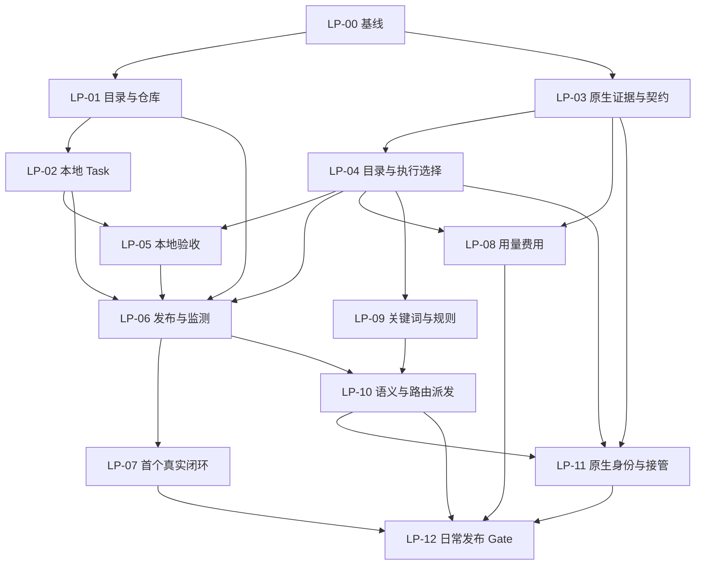

# Dispatcher 单人本地可用流程：架构增量与开发计划

日期：2026-10-07。状态：开发安排建议；本文没有改变 Linear 状态、合并 PR 或实施新产品功能。

## 1. 交付目标与安排结论

按可使用的操作链交付：稳定基线 → 手动本地发布 → 用量与费用 → policy 自动选择 → 原生会话查看和接管 → 日常使用与恢复验收。

第一条链必须是：登录网页 → 系统目录选择器选择项目 → 选择 harness/账号 → 明确选择模型和原生思考强度 → 输入任务并补齐必要的验收信息 → 开始 → 在「任务与运行」查看进展 → 回复问题或取消 → 查看改动和验证结果 → 人工验收。

第一版允许只开放一个经过真实验证的本地 harness。完整原生交互版本遵守 M17.2 既有首发范围，OpenCode 与 Codex 都需要各自的真实往返证据。其他 harness 按证据逐个开放。账号支持执行、支持模型目录、支持原生历史、支持接管是不同能力，分别声明。

本地发布的任务创建和监测不依赖 Slack 或 Linear。建议同时补齐既有 `delivery.type = none` 的本地结果验收路径，使没有 GitHub 的 Git 项目也能结束运行并等待人工验收；这是一项明确的 Controller 行为增量，不能把现有代码说成已经支持。GitHub PR 路径继续保留。首次发布范围采用受管 Git worktree，普通非 Git 目录给出明确原因，不自动初始化、复制或在原目录执行。

## 2. 当前基线与审计边界

- 工作仓库：`/Users/wangdongxin/projects/dispatcher`；remote：`https://github.com/Arragon/Dispatcher.git`。
- 当前分支：`codex/mac-priority-harnesses`；HEAD：`a1e80830620c9fe2482b4293d9c79c1d66772cae`。
- 2026-10-07 读取远端 main：`af00240b6d62999065141ea390df29d6fe4bbd26`。
- [PR #5](https://github.com/Arragon/Dispatcher/pull/5)、[PR #6](https://github.com/Arragon/Dispatcher/pull/6)、[PR #7](https://github.com/Arragon/Dispatcher/pull/7) 均 OPEN；#7 是 draft；其依赖顺序为 #5 → #6 → #7。#7 远端 head `2f18a36…` 与当前本地 HEAD 不相同。
- 当前工作区还有登录、Console、任务操作、模型证据等未提交改动。本次构建和定向测试覆盖当前工作区，不能转作 main、远端 PR head 或部署版本的证明。
- Linear 项目 [Agent Dispatcher](https://linear.app/inhandy/project/agent-dispatcher-98b768613d26) 已完整读取两页，292 个唯一 issue；本计划相关三个里程碑共 108 个。附录记录元数据覆盖；关键执行路径按源码与所选 issue 正文核查，未做 108 张票的逐票正式验收。

| 里程碑 | 当前票数与状态 | 在本计划中的责任 |
| --- | --- | --- |
| M6.1 | 14；Done 4、In Review 3、In Progress 1、Backlog 6 | 稳定执行、必要网页操作、备份恢复、真实日常 Gate |
| M17.1 | 26；全部 Backlog | 模型目录、单次选择、用量费用、发布 UI、两种模式与路由 |
| M17.2 | 68；全部 Backlog | 原生身份/历史、接管/交还、工作区保护、原生首发 Gate |

状态是计划平台的工作状态，不是实现完成率。Done 工作保留；In Review 先审查其现有增量与证据；Backlog 中如果发现已有部分实现，只补差距并记录，不能重复建设。

### 2.1 关键证据对照

| 能力 | 当前实现证据 | 验证与 Gate | 后续映射 |
| --- | --- | --- | --- |
| 单人登录 | `apps/controller/src/control-auth.ts`、未跟踪的 `owner-password.ts`、`apps/web/src/App.tsx` | 本次 personal-mvp/app 定向回归通过；未做本次真实浏览器验收 | INH-1384 Done 保留；LP-00 整理工作区交付 |
| 派发/续租/交付 | `apps/controller/src/service.ts` 的共享 `dispatchTask`、`advanceRun`、generation/lease 和 delivery reconcile | personal-loop/background 定向回归通过；真实 Slack/CI Gate 待证据；INH-1382/1383/1396 In Review | LP-00、LP-05、LP-12 |
| 任务监控和回复 | `TasksPage.tsx`、未跟踪的 `TaskActions.tsx`、Fleet/SSE、会话 input 路由 | console/app/controller 定向回归通过；新本地任务入口未验收 | INH-1385 In Progress；LP-06 |
| 独立发布页/本地任务创建 | 当前 App 路由没有发布页；Task API 有读、archive、dispatch，没有独立本地创建入口；外部创建由 `processExternalTaskEvent` 完成 | 未实现；无新发布真实 Gate | INH-1469；LP-01/02/06/07 |
| 单次模型/effort | `TaskDispatchBody` 当前没有这些字段；Adapter/Scheduler 链尚未接入新选择契约 | 新能力未实现，不能用 `Run.model` 显示证明执行参数有效 | INH-1471–1480；LP-03/04 |
| 本地结果结束 | `TaskContract.delivery.type` 已有 `none`；Controller DELIVERING 当前仍要求 owner/name 和 GitHub connector | 契约值存在，运行路径未实现 | LP-05；建议补入 INH-1466 的集成关联或单独实现票 |
| 通用累计用量/额度/估算 | 部分 Run/Adapter 字段和最新回合数据存在，缺统一范围、累计、费用来源 | 当前 UI 数据不等于通用实时计量 | INH-1467、1481–1485；LP-08 |
| policy 与语义分类 | 两份 spec 和 Linear W7 已建；代码没有新 `task_classifier` 和路由决策链 | 设计完成，功能未实现 | INH-1837–1840；LP-09/10 |
| 原生同会话接管 | Adapter session/providerSessionId 是基础；未实现完整 SessionControl 和接管往返 | 网页日志和输入回复不是同会话原生接管证明 | INH-1486–1491；LP-11/12 |

实现依据以当前源码为准；既有 `dispatcher-slack-linear-mvp-plan.md` 的 2026-10-01 缺口描述只用于追踪，不把已补齐的 worker/auth/dispatch 再列为从零开发。

## 3. 架构增量和关键决策

### A1：发布独立，任务和运行监测继续复用

新增「发布任务」路由和表单，建议文件 `apps/web/src/PublishPage.tsx`，此路径是拟新增。发布成功跳转已有任务/运行详情。TasksPage 不承担另一个创建向导；发布页不另建日志或任务状态数据库。

### A2：目录由本机服务确认，执行由受管 worktree 承担

系统目录选择器在 Controller 所在本机打开；首次只支持本地 loopback、登录用户、交互式桌面会话。浏览器目录上传/选择返回文件句柄，并不能直接作为 Controller 可使用的绝对目录。本机桥接必须实际证明“打开系统目录窗口 → 返回本机所选根目录”。目录取消不改变配置、不创建 Task。

优先复用现有 PlatformAdapter/RepositoryRegistry/WorkspaceManager。选择器实现先评估系统原生能力或成熟实现的维护、许可证、打包和后台运行条件，再采用最小实现；不在计划中指定未经核验的新依赖。没有桌面交互会话时明确报错，不能以手填路径冒充满足系统资源管理器的验收。

服务端核对 canonical realpath、Git 根、baseRef、scope 和已有登记。同一仓库重选不重复注册。新增 repository 配置走 ConfigPlan；选择目录不直接修改配置。初版 worktree 从明确的 commit/baseRef 创建；原目录未提交修改不自动带入，界面在开始前说明这一点，禁止擅自 stash/reset/clean。

### A3：本地 Task 进入既有 canonical 与 TaskContract 链

新增本地创建入口，建议 `POST /api/local-tasks`。服务端记录来源和 principal，不能由客户端伪造 connector 来源。复用 canonical task commands、revision、持久化和 Fleet 投影，不伪造 Linear ExternalBinding。

输入任务文本后，仓库登记提供 scope、允许的 verification command IDs 等默认上下文；用户确认验收标准。复用 TaskContractCompiler：缺 repository/scope/acceptance/verification 时保留 NEEDS_SPEC 草稿并指出需要补充的内容，不制造空测试或空验收。表单可展示必要补充信息，内部模型不可暗自放宽合同。

创建请求、编译和开始请求各保留可重试收据。先持久化 canonical Task，preflight 成功才调用共享 dispatch；启动失败保留任务和诊断。请求失响应后可查询原结果，再用同一请求身份重试，不生成第二个 Task 或 Run。旧 HTTP/Slack 入口兼容策略按来源分开，新本地任务不能省略参数走旧默认分支。

### A4：模型与思考强度沿同一事实链传递

原生 CLI/协议 → Adapter 规范化目录、价格与 effort → Controller 校验/决策 → Scheduler/Runner → Adapter 原生 argv/request → Run 与原生 Session 绑定 → Fleet/SSE → 页面。

手动选择和 policy 选择消费同一个 immutable modelSelection。内部 LLM 只提供任务分类，不能选择账号、修改规则、启动任务或改变权限。domain/protocol 只承载纯类型；ConfigPlan 负责规则、开关、默认值；provider 解析留在 Adapter。

所选项目/账号变化清除旧目录和决策；选择模型和开始前重新查询。CLI 只给缓存时标明新鲜度未确认；查询失败/已过期阻止新启动。查询成功但价格字段缺失可以执行，显示「未提供」。某 backend 无可核验的原生模型目录时，不以平台静态文件补齐：保留旧能力，阻塞该 tuple 的新模型选择发布 Gate。

原生默认 effort 也是用户明确选择的模式；不伪称 medium，不向 prompt 填「多思考」冒充 effort 参数。账号默认模型是可明确采用的候选，自动模式未匹配时不能兜底。

### A5：本地完成与 PR 完成分别交付

建议把 `delivery.type = none` 接到现有验证和 REVIEW 语义：required verification 通过后结束 Run，Task 等待人工验收，保留 worktree、改动、结果和验证记录；GitHub 未配置时可完成此链。`none` 表示无 SCM 发布副作用，不表示省略验证、伪造 commit/PR/CI evidence 或自动标记验收成功。

复用 canonical command 完成人工接受，服务端核对当前 Task/Run 和验证对应的候选版本；候选改动后原验证不再满足验收。具体候选标识和持久化布局先在 LP-02 定义，避免后续原生接管另建一份事实。既有 pull-request 路径仍按 GitHub/reconcile 和 REVIEW 配置执行。commit-only 能力不借本票顺带宣称已实现。

### A6：费用、额度和资源状态分开

本回合、Run、native Session、账户周期的范围显式标注。按事件身份处理增量和累计；缓存是否包含于输入按原生语义处理。缺失不是 0。账户额度不能直接当作某任务消耗。

原生实际消耗和估算分别显示。只有原生给计费基准、真实用量和有效倍率/优惠条件时才算估算；原生最终单价不重复乘优惠。价格变化分段保存来源；信息不足显示「无法估算」。内部分类调用计量单列。后端只有结束时上报时，页面写明更新时机，不承诺持续增长的实时数字。

### A7：原生查看和人机写入权独立开放

只读历史、原生入口、同 session 续接、human takeover 各自有证据。原生终端/GUI 的入口必须指向记录的 exact session、存储域、账号和 worktree。接管先冻结自动写入，再等待静止/释放；交还核对身份、模型、权限和候选版本，授予新控制 epoch 后重做验证。HUMAN/CONFLICT/UNKNOWN 时所有入口禁止自动写入与交付。关闭功能和重启不能解除保护。

## 4. 六个交付阶段与退出门槛

| 阶段 | 工作与既有票 | 可交付结果 | 退出 Gate |
| --- | --- | --- | --- |
| P0 稳定基线 | LP-00；INH-1382/1383/1396 审查收尾、1385 网页操作；NS-001 | 可追溯集成候选、现有 Console/登录工作区交付边界 | 精确 SHA 和 patch 清单，根门禁通过；PR 审查/集成按既有流程，未合并时明确标候选 |
| P1 手动本地闭环 | LP-01–07；M17.1 W0/W1/W2/W4/W5 的一个真实 tuple | 独立发布页、系统目录选择、本地 Task、模型/effort、后台执行、回复/取消、结果验收 | 一个真实 harness 证明选择→执行参数→文件改动→required verification→人工 REVIEW；无 Linear/Slack 也能创建和监测，关闭网页仍继续 |
| P2 用量和费用 | LP-08；INH-1467/1481–1485/W4/W5/W6 | 原生 token/缓存/额度、实际与估算消耗 | 范围与去重正确，倍率可复算，缺失不填 0，非阻塞读取；至少一个所选 tuple 真实计量证据，其余按字段关闭 |
| P3 两种模式与路由 | LP-09/10；INH-1838/1839/1840、1469/1470 | 关键词与可选内部语义分类；policy 决定模型/effort；两个开关 | 无匹配不建 Run；确认关亦如此；账号固定、冲突停止、陈旧决策失效；语义异常处理与调用用量可核对 |
| P4 原生同会话交互 | LP-11；M17.2 W0–W4、NS-032 | 只读追溯后开放原生查看、接管、交还 | OpenCode NS-040 与 Codex NS-043 的本地首发 Gate 分别通过；same identity、人机互斥、人工改动后重新验证；单 backend 中间成果不代表 M17.2 完成 |
| P5 日常与恢复验收 | LP-12；M6.1 未完成日常 Gate、M17.1 W6、M17.2 W5 | 可恢复、可诊断的个人日常版本与操作手册 | 备份恢复/重启/故障不重复执行或交付；真实日常链、现有 Slack/API 回归、所选组合与主机资源证据齐全 |

P1 是第一个可以日常试用的版本，不代表 M17.1/M17.2 全部 Done。P5 保留原里程碑的正式验收条件，包括 INH-1387 的真实 Slack–Linear–GitHub 链和 NS-066 的原生往返链；不得因为新增本地发布而删掉原 Gate。

P2 在 P1 的 contracts 稳定后可与 P3 工作独立推进；P4 的证据矩阵、ADR 和只读部分可提前准备。实际执行按任务前置条件，不能同时修改尚未冻结的 shared contracts。没有投入人数或速率证据，本计划只给顺序与门槛，不承诺日期或工期。

## 5. 可执行任务卡

以下 LP 编号是本文规划编号，不是新建的 Linear issue。建议拆出的发布子任务挂到 INH-1469；公共模型、计量和路由实现沿用既有票，不复制另一套服务。所有实现 PR 必须记录 base/head、相关 workspace patch、命令结果及 required evidence；涉及 shared contracts/持久化/权限的 PR 执行 `pnpm check`。

### LP-00 · 锁定可实施基线与现有工作交付边界

- **映射/设计**：INH-1382、1383、1396、1385、NS-001/INH-1496；A1–A7。
- **依赖/输入**：当前 HEAD、未提交 patch、三个 PR 的最新审查/CI、既有架构与 know-how。
- **模块/输出**：现有 controller、runner、integrations、Console、auth 增量；输出 baseline manifest、逐项差距、按责任分组的提交/PR 方案和执行基线。
- **实现**：先审查续租、currentRunId、等待回复、CI pending/changed-head 和进程失败路径；保留当前 UI/auth 成果，识别尚未提交的实现与远端差别。新功能的可运行发布从实际集成基线做，不基于“票已 Done”猜测。
- **验收/验证**：`pnpm check` 通过；长任务、旧 generation、回复重试、重复 dispatch、CI pending 都有现有测试或新增缺口测试。零 checks 标为 pending/unknown，不判成业务完成或据此认定代码失败。真实 Gate 保持待证据。
- **风险/退出**：不得丢弃用户改动、自动合并 stack、重开 Done；需要跨冻结边界的差异先出设计变更说明。

### LP-01 · 系统目录选择、仓库识别和登记

- **映射/设计**：建议 INH-1469 子任务；A2。
- **依赖/输入**：LP-00；现有 ConfigPlan、RepositoryRegistry、WorkspaceManager、PlatformAdapter；实际 macOS 桌面条件。
- **模块/输出**：`packages/workspace/src/workspace.ts`、controller、config、web；拟新增本机选择器模块；输出受鉴权的选择结果、仓库预览及 repository ConfigPlan。
- **实现**：先做无文件改动的 native-dialog 探针；审查复用实现/许可证。返回绝对根目录，服务端 canonicalize，识别 Git 根/baseRef/dirty 状态；已登记仓库复用；未登记通过 ConfigPlan 应用。verification 命令采用已登记/受控配置，不能把任意任务文本变成 shell。
- **验收/验证**：真实系统窗口选择、取消、含空格/中文目录；重复选择幂等；无桌面/非 Git/权限不足/路径替换给出原因；ConfigPlan revision 冲突可见；不修改源工作区。定向 `pnpm vitest run packages/workspace/test/workspace.test.ts`，controller/config 的现有或新相关测试另在实现时确定。
- **风险/退出**：本机选择器不可用阻塞“系统资源管理器已支持”的声明；远程网页不默认借此浏览服务器目录。

### LP-02 · 本地 Task 创建与验收合同

- **映射/设计**：建议 INH-1469 子任务，关联 INH-1466/NS-006；A3/A5。
- **依赖/输入**：LP-00、LP-01 的仓库身份；现有 TaskDraft、canonical commands、TaskContractCompiler、delivery.none 类型。
- **模块/输出**：controller/service、integrations 的 canonical 命令、semantic compiler、persistence；拟新增 local-task API 模块和回归文件。输出本地来源、草稿/编译缺口、明确的验证/交付配置、持久创建收据。
- **实现**：合同必填仍执行；配置提供范围和允许的 command IDs，页面收集真实验收标准；缺失存 NEEDS_SPEC。定义本地 REVIEW 的候选标识和人工接受命令，复用 revision/事务，不伪造外部任务绑定。
- **验收/验证**：无 Linear connector 可创建；重复创建/失响应重试/重启只返回同一 Task；NEEDS_SPEC 不允许 dispatch；伪造来源/principal 被拒绝；任务 revision 与合同 revision 一致。使用现有 controller/semantic/persistence 测试入口并补新增 API 集成测试，`pnpm check`。
- **风险/退出**：不得用空 verification/验收使合同 READY；持久化增量必须验证新旧数据库、回滚与 opaque secret 边界。

### LP-03 · 真实账号模型/价格/effort 能力与公共契约

- **映射/设计**：INH-1471/1472/1473、INH-1468；与 NS-002/003/005/006 协商；A4。
- **依赖/输入**：LP-00；实际选用的 binary/backend/账号版本，已有 adapters/contracts。Codex 是现有执行链候选，OpenCode 是另一首发候选，最终开放资格由探针决定。
- **模块/输出**：adapters/domain/protocol/persistence；输出版本化 capability 与证据表、ModelCatalog/ModelSelection/Pricing/effort 契约及迁移。
- **实现**：逐 tuple 查安装帮助与当前官方原生接口；只读查目录/费率/额度不发推理；随后在 disposable repo 验证选定模型/effort 实际可传入。区分目录成功、访问权限未确认和价格未提供；不能静态补价格。契约与 M17.2 共享一份选择记录。
- **验收/验证**：account/project/backend 隔离；原生值及能力可 round-trip；无目录/过期失败阻止新选择入口；不支持 effort 不伪造；新旧数据兼容和 domain/protocol purity 通过。既有 adapter contract 测试 + 新 fixture，`pnpm check`；实测输出脱敏留证。
- **风险/退出**：原生能力未知或不可用阻塞该 tuple，保持未验证项关闭，不改换渠道或使用公价/平台文件补齐。

### LP-04 · 目录服务、默认模型和单次执行选择

- **映射/设计**：INH-1474–1480；A4。
- **依赖/输入**：LP-03、LP-00；目录查询契约、既有 dispatch 与 Scheduler/Runner。
- **模块/输出**：controller、config、scheduler、runner、adapters、domain/persistence；输出目录 API、ConfigPlan 默认候选、preflight 和不可变 Run/session 选择。
- **实现**：按账号/项目上下文查目录；默认模型通过 ConfigPlan 保存。单次 model/effort 贯穿 dispatch→native argv/request，续接与重试保持冻结选择，实际上报独立保存。开始前刷新并比较变化，返回可操作冲突，不偷偷换模型或账号。
- **验收/验证**：两个并发任务选不同模型互不污染；账号默认变更不改运行；原生默认显式选择；目录错误阻断、成功但价格缺失可执行；响应丢失不重复 start。执行相关 contract/integration 回归及 `pnpm check`，一个真实 tuple 证明请求与运行对应。
- **风险/退出**：共享可变 adapter 配置不能承担 per-run 选择；当前旧入口行为按兼容契约保留，新 local-origin 不走默认兜底。

### LP-05 · 无外部发布的本地结果与人工验收

- **映射/设计**：建议独立新增实现票，关联 INH-1466/1469/1383；A5。
- **依赖/输入**：LP-02、LP-00；既有 verification、delivery none 与 REVIEW 语义，LP-04 是新模型发布集成的前置。
- **模块/输出**：controller/advanceRun、integrations/canonical commands、Fleet/web；输出本地结果记录、改动定位、required verification 及人工接受路径。
- **实现**：按合同分支处理 none，验证通过后结束执行并保留待人工验收的任务。无 SCM 发布不创建 GitHub 副作用；暴露明确结果/改动/版本/验证摘要。人工验收命令检查当前候选，无需混入 PR reconciliation。
- **验收/验证**：未配置 GitHub 的 disposable Git repo 能到 REVIEW；required 失败不成功；重启不重复终态/验收；候选变化使旧验证不可用于接受；pull-request 路径的 pending/failed/changed-head 回归不变。新增 none-path 集成测试 + personal-loop，`pnpm check`。
- **风险/退出**：不要扩成任意原目录执行或自动 merge；任何新增 evidence 类型/持久化字段先审查契约，不能将本地结果伪装成 GitHub evidence。

### LP-06 · 发布页和现有监测操作集成

- **映射/设计**：建议 INH-1469 子任务；INH-1385；A1–A5。
- **依赖/输入**：LP-01/02/04/05；auth、Fleet、SSE、TaskActions、preflight 错误。
- **模块/输出**：拟新增 PublishPage；已有 App、api、AgentsPage、TasksPage、TaskActions；输出一个手动发布表单及直接进入当前运行的导航。
- **实现**：目录→harness/账号→模型/effort→任务/必要合同补充→开始。切换上下文清除旧选择；明确采用账号默认；显示查询/阻塞/资源等待原因。发布成功进入 canonical Task 的 currentRun。关闭网页仍后台运行，重开回读真实状态。
- **验收/验证**：真实系统目录流程；双击/超时不重复；WAITING_USER 回复原会话、旧 revision 被拒绝；取消/资源恢复有反馈；没有任务时直接去发布；不把假百分比显示为进度。existing app/console 测试 + 新发布交互测试，controller 集成测试和真实浏览器录屏/截图。
- **风险/退出**：TaskActions 现有语义确认与“自动模型确认”不同；不因关闭模型确认跳过权限、合同或其他操作确认。

### LP-07 · 首个手动发布真实闭环 Gate

- **映射/设计**：INH-1470 的阶段验收，关联 INH-1385；A1–A5。
- **依赖/输入**：LP-06；候选 SHA、测试报告、可丢弃 Git 项目、已完成原生认证的一个 tuple。
- **模块/输出**：不增加新执行逻辑；输出真实账号/browser evidence bundle 和支持矩阵。
- **验收/验证**：实际文件产物、selected/reported model、effort argv/request、受管 cwd/PWD、后台推进、等待回复、取消、required 失败、本地 REVIEW/人工接受都留证；断开网页及 Controller 重启不重复 start。回放/fixture 报告与真机分别记录。
- **风险/退出**：登录、目录查询或一次问答不能替代开发产物；任何 required 项无证据只发布有界试用能力，不标 M17.1/M17.2 整体 Done。

### LP-08 · 非阻塞用量、账户额度和倍率估算

- **映射/设计**：INH-1467、1481–1485、1468/1469/1470；A6。
- **依赖/输入**：LP-03/04；初始真实数据形态和 pricing snapshot。
- **模块/输出**：Adapter、controller、domain/persistence、Fleet/SSE、Agents/Tasks 页面；输出具范围/单位/来源/时间的 UsageSnapshot 与可复算估算。
- **实现**：非阻塞读事件/快照；增量/累计去重和分段费用；缓存关系由 adapter 规范化；原生最终价和倍率基准互斥；账户指标独立。上游没提供的字段按缺失展示。
- **验收/验证**：重复事件/重启/断流补偿不重复累计；缓存不重复计费、免费/优惠/倍率/价格变化可复算；原生实际和估算不相加；不得读计量时等待完整回合或创建推理。normalized fixture + 真账号事件与画面，`pnpm check`。
- **风险/退出**：只有倍率、没有基准时无法算绝对消耗；账户余额差有并发干扰时不得归因到单任务。发布能力按字段和更新时机声明。

### LP-09 · 关键词规则、开关与规则试算

- **映射/设计**：INH-1838/1837、1469；A4。
- **依赖/输入**：LP-03/04；07 spec、ConfigPlan，既有 internal LLM roles 仅供后续扩展。
- **模块/输出**：config/domain、纯规则匹配模块、controller、Settings/Publish UI；输出任务类型、project/global 规则、全局启用和确认开关、可解释预览。
- **实现**：中文/英文关键词 any/all/exclude；项目规则优先、显式优先级和冲突规则；试算与正式决策共用 matcher，未应用 config 试算不得启动。全局开关关闭只提供手动模式。
- **验收/验证**：四种开关组合、账号隔离、同目标合并/不同目标冲突、胜出无效规则停止；无类型/规则匹配时提示手动并阻止 Run，即使账号有默认且确认关闭。定向 matcher/config/UI tests，`pnpm check`。
- **风险/退出**：关键词阶段可以先演示试算；INH-1840 当前还依赖 INH-1839，语义未完成时不把整个 W7 标 Done，也不绕过其依赖偷偷发布全功能。

### LP-10 · 内部语义分类、决策确认和派发

- **映射/设计**：INH-1839/1840、1469/1470；A4/A6。
- **依赖/输入**：LP-09、LP-04/06；内部模型已配置且可用，07 spec 分类 schema 与 conflict/failure 策略。
- **模块/输出**：llm-runtime 新 task_classifier role、分类边界、controller/semantic/persistence、Publish/Settings/Tasks UI；输出严格分类结果、独立分析用量、ModelRoutingDecision 和确认/派发收据。
- **实现**：语义仅输出类型、依据、置信信息和受约束状态；合并关键词结果后 policy 选模型/effort。绑定输入/revision、项目/账号、规则版本、目录/价率和有效期；服务端认可确认开启后的具体 decision，关闭记录配置豁免。手动明确选择记录 explicit-selection。
- **验收/验证**：提示注入/非法类型/超时/冲突按设计停止或按已配置的唯一关键词降级；没有匹配规则绝不默认；用户改任务/配置/账号后旧确认失效；陈旧费率刷新需重新审视变化；双击/丢响应/重启只创建一个 Run。四开关矩阵、真实分类来源/用量和真实执行参数证据，`pnpm check`。
- **风险/退出**：不让 classifier 执行工具或改 ConfigPlan；旧来源/伪造 confirmed 不能绕过新来源校验；内部模型不可用仍能手动发布。

### LP-11 · 原生身份、历史与安全接管分批交付

- **映射/设计**：INH-1486–1490；NS-001–027、029–035、037–043；A7。
- **依赖/输入**：LP-00/03/04 的公共契约；完整两种模式发布集成还需 LP-10；05 doc 的既有任务依赖；不要求先完成所有费用 UI。
- **模块/输出**：domain/protocol、persistence、adapters、controller/runner、Tasks/Agents 页面；输出精确 session identity、只读历史、原生入口及 SessionControl。
- **实现顺序**：NS-001–008 → NS-009 → NS-010/011/012；NS-008/009 → NS-019。NS-017 和 NS-018 必须等 NS-019。历史 NS-014/015/016 先作为有界只读结果；随后 NS-020/021/022 → NS-023/024/025，集成 NS-026/027/029–035/037。NS-032 消费 P1 同一发布流程和 LP-10 决策，追加原生交互要求。
- **provider 顺序**：公共契约稳定后 OpenCode NS-038/039/040 优先做一个 GUI 往返；Codex NS-041/042/043 独立核对 App 来源、存储域、writer 与发现条件。全里程碑首发声明必须两者各自通过；其他 CLI/TUI/GUI 不跟随自动获得支持标签。
- **验收/验证**：同 Task/Run/native ID、auto→human→auto、所有写入口 fence、未知启动/未知停止不重发、原生改动后重新验证、旧 lease/epoch 无交付权、主机重启恢复。新增 typed contract/竞态/迁移测试；NS-040/043 真机证据独立于 `pnpm check`。
- **风险/退出**：GUI 发现/锁/删除语义未知时保留只读层，阻塞对应接管；不在日常项目做归档/删除实验，不以打开一个新终端当接管完成。

### LP-12 · 备份、每日操作与正式个人发布 Gate

- **映射/设计**：INH-1386/1387/1388/1389/1390、1470、1491；NS-063–070；A1–A7。
- **依赖/输入**：备份实现可从 LP-00 稳定持久化边界开始；最终 Gate 等 LP-07/08/10/11 和各既有票的完整 blockedBy。
- **模块/输出**：operations、数据库备份/恢复、worktree cleanup、diagnostics、benchmark；输出操作手册、backup manifest、恢复和故障报告、分 tuple 支持表。
- **验收/验证**：在隔离数据目录演练备份→破坏→恢复；canonical revision/task/run/模型决策/session/evidence 一致；dirty/不明目录不清理；恢复不重复 Agent/PR；功能禁用不解除 HUMAN/UNKNOWN 保护。真实运行覆盖 Need Attention、RESOURCE_BLOCKED、取消、分类模型不可用、外部 API 超时、双 Codex profile 和第二供应商组合；真实 Slack 与原生往返按原 Gate 验收。
- **命令/证据**：`pnpm check`；`pnpm benchmark -- --scenario smoke --duration 5` 提供受控基线，真实日常主机资源另采集，不将 5 秒 smoke 等同长期稳定性。按 NS-068 对实际新增依赖/原生协议审查安全和许可证。提供版本、数据恢复点、逐项失败/通过/未提供状态和发布回退步骤。
- **风险/退出**：任何 required Gate 缺证据不能宣称完整个人发布；中间阶段可继续有界试用，但不弱化既有准入条件。

## 6. 依赖、关键路径与首批执行安排

LP-11 的完整交付依赖 LP-10；前期 Session identity/history/contracts 可以先做，不依赖语义分类。其子图采用 05 doc 的 NS 依赖，不能用上图的一条边替代所有内部前置条件。

**P1 关键路径**：LP-00 → LP-03 → LP-04 → LP-05/06 → LP-07；LP-01/02 是另一支必需输入。如果原生目录能力未确认，LP-03 就是明确的阻塞点，发布 UI 不能靠静态模型名单抢先宣布可用。

**首批工作**：

1. LP-00：审查 #5/#6/#7 与已有 Console/password patch；收尾 INH-1382/1383/1396/1385 的真实差距，确定后续候选基线。
2. 做 LP-01 原生目录探针和 LP-03 所选账号能力审计；两者是独立读证据工作，先输出成功/失败结论。
3. 协商 INH-1472/1473/1479 与 NS-003/006 的 shared contracts，再做 LP-02 本地 Task 和 LP-04 单次选择。
4. 完成 LP-05 本地结果、LP-06 手动发布，以及 LP-07 真机闭环；这批产物到齐才称第一版可试用。
5. LP-08 计量与 LP-09/10 路由按共享契约推进；LP-11 按先只读后接管的准入条件推进；LP-12 保留完整正式发布 Gate。

## 7. Linear 排期建议与延后范围

| 对象 | 建议安排 | 保留事项 |
| --- | --- | --- |
| M6.1 In Review 三票与 INH-1385 | 第一批完成审查和集成缺口，避免继续在未知基线上扩展 | Done 1380/1381/1384/1395 不重开；PR 不自动合并 |
| INH-1469 W5 | 拆出目录登记、本地 canonical 创建、发布 UI 和浏览器 Gate；本地 none-path 另列明确实现责任 | 不复制 W2 执行选择和 W7 matcher；所有新增 LP 编号仅为建议 |
| INH-1471–1480 | 从一个真实 tuple 完成纵向链，再扩其他原生 backend | 先 evidence/contract，再 service/exec，再 UI；历史调用者回归保留 |
| INH-1838/1839/1840 | 规则 → 分类 → 决策/确认/dispatch；UI 消费契约 | 现有依赖不擅自删；关键词中间成果只能有界验收 |
| INH-1527 NS-032 | 在手动发布基础上增加交互要求及路由集成 | basic publish 的第一版不必等待全部 takeover，NS-032 自己仍满足 NS-007/010/019 |
| M6.1、M17.1 W6、M17.2 W5 | 按各版本做阶段验收，最终正式 Gate 独立执行 | 本地测试、PR 状态和真账号证据分别判断 |

M12.1 Remote Runner、M17.3 云端/自托管、更多未验证 harness、团队协作增强、RHIZA X1 联动、M19 经验学习/流程进化不进入首个本地闭环的关键路径。它们的既有任务保留，不取消，不借本计划自动改期。基础事件和版本记录按现有架构保留，为将来复盘提供事实。

## 8. 已执行检查与后续验收边界

本次规划审计在当前 HEAD + 未提交 workspace patch 上执行：

| 检查 | 当前结果 | 能支持的结论 |
| --- | --- | --- |
| `pnpm build` | 退出 0 | 当前各包和 Web 可构建 |
| `pnpm vitest run apps/controller/test/personal-loop.test.ts apps/controller/test/personal-mvp.test.ts apps/controller/test/background.test.ts apps/controller/test/console-projection.test.ts apps/web/test/console.test.tsx apps/web/test/app.test.tsx packages/workspace/test/workspace.test.ts` | 退出 0；7 files / 56 tests passed | 现有个人执行、等待回复/幂等、登录、监测和 workspace 的定向回归 |

本次没有执行完整 `pnpm check`、真实新发布浏览器流程、原生目录/模型/计量探针、真实 Slack/CI Gate、备份恢复或同 native session 接管。新功能仍是规划，不能用上述旧功能回归替代。实施任务从 `package.json`/既有 tooling 采用命令；新增测试文件必须真实创建后才列为可执行入口。

## 9. 设计来源与追踪

- 当前 `AGENTS.md`、[architecture](docs/architecture.md)、[know-how](docs/know-how.md)、冻结设计 `agent-dispatcher-architecture-roadmap-v2026-09-15.md`：边界、命令与兼容约束。
- [06 · 本地任务发布、模型选择与用量估算设计](https://linear.app/inhandy/document/06-本地任务发布模型选择与用量估算设计-31a017057a6e)；仓库 spec：`docs/superpowers/specs/2026-10-04-agent-model-selection-design.md`。
- [07 · 两种任务创建模式与关键词/语义 policy 路由设计](https://linear.app/inhandy/document/07-两种任务创建模式与关键词语义-policy-路由设计-47e3eb67283b)；仓库 spec：`docs/superpowers/specs/2026-10-06-task-routing-policy-design.md`。
- [05 · Native Harness Session Interaction 详细设计与开发计划](https://linear.app/inhandy/document/05-native-harness-session-interaction-详细设计与开发计划-2026-10-05-2a1cefdd8896)：NS 原生交互内部依赖和真实 Gate。
- [04 · 基本功能开发计划](https://linear.app/inhandy/document/04-基本功能开发计划-2026-10-01-94e6bbccdae0)：M6.1 原正式 Gate。
- 当前 GitHub PR 状态由 Arragon/Dispatcher 实时读取。05 doc 中 Linear 自动生成的部分 PR 预览名指向 Rhiza-Dev；核对时采用上列 Dispatcher 的实际 GitHub URL，不能按错误的预览名识别仓库。

| 需求 | 架构 | 实现任务 | 验收 |
| --- | --- | --- | --- |
| 系统目录选择与独立发布 | A1/A2/A3 | LP-01/02/06 | LP-07 系统窗口与 canonical Task 真机证据 |
| 账号默认、原生实时模型/价格、effort | A4 | LP-03/04/06 | per-tuple 原生查询/请求和不可变选择 |
| 无外部任务源也可运行/接受结果 | A3/A5 | LP-02/05/06 | 无 Linear/Slack/GitHub 的本地 REVIEW 链 |
| token、缓存、账户额度和倍率估算 | A6 | LP-08 | 分范围原生上报、去重、估算复算 |
| 手动/自动两种模式、开关、确认 | A4 | LP-09/10 | 无匹配不启动、四开关、失效/幂等 |
| 内部语义识别匹配 policy | A4/A6 | LP-10 | 严格分类、冲突/失败、分析调用用量 |
| 同会话原生查看/接管/交还 | A7 | LP-11 | NS-040/043、旧写权拒绝与重新验证 |
| 可恢复的个人日常使用 | A1–A7 | LP-00/12 | 原正式 Gate、恢复、回归、主机基线 |

## 附录 A：相关 Linear issue 元数据覆盖

下表来自本次完整分页的 108 项相关 issue。它记录计划映射和工作状态，不代表每票已经逐项查代码或通过验收。关键源代码审计见 2.1；详细实现/验证/外部 Gate 以任务卡和其原 issue 正文为准。

| Issue | 计划项 | 当前状态 | 本文/原设计映射 |
| --- | --- | --- | --- |
| [INH-1380](https://linear.app/inhandy/issue/INH-1380/m61-w1-t01-恢复可复现质量基线与-ci-可运行性) | [M6.1-W1-T01] 恢复可复现质量基线与 CI 可运行性 | Done | 04；LP-00/06/12 |
| [INH-1381](https://linear.app/inhandy/issue/INH-1381/m61-w1-t02-实现-run-projection-后台推进-worker-与重启恢复) | [M6.1-W1-T02] 实现 Run / Projection 后台推进 Worker 与重启恢复 | Done | 04；LP-00/06/12 |
| [INH-1382](https://linear.app/inhandy/issue/INH-1382/m61-w1-t03-实现长任务-lease-续租-过期-generation-fencing-与进程-spawn-失败路径) | [M6.1-W1-T03] 实现长任务 Lease 续租 / 过期 / Generation Fencing 与进程 Spawn 失败路径 | In Review | 04；LP-00/06/12 |
| [INH-1383](https://linear.app/inhandy/issue/INH-1383/m61-w1-t04-实现-delivery-ci-evidence-持续-reconcile-与-linear-完成语义) | [M6.1-W1-T04] 实现 Delivery / CI Evidence 持续 Reconcile 与 Linear 完成语义 | In Review | 04；LP-00/06/12 |
| [INH-1384](https://linear.app/inhandy/issue/INH-1384/m61-w1-t05-单用户控制面认证principal-来源与-runner-enrollment-凭据交付加固) | [M6.1-W1-T05] 单用户控制面认证、Principal 来源与 Runner Enrollment 凭据交付加固 | Done | 04；LP-00/06/12 |
| [INH-1385](https://linear.app/inhandy/issue/INH-1385/m61-w2-t01-dashboard-个人-mvp-必要操作与错误反馈) | [M6.1-W2-T01] Dashboard 个人 MVP 必要操作与错误反馈 | In Progress | 04；LP-00/06/12 |
| [INH-1386](https://linear.app/inhandy/issue/INH-1386/m61-w2-t02-personal-sqlite-备份-恢复演练与安全-orphan-worktree-cleanup) | [M6.1-W2-T02] Personal SQLite 备份 / 恢复演练与安全 Orphan Worktree Cleanup | Backlog | 04；LP-00/06/12 |
| [INH-1387](https://linear.app/inhandy/issue/INH-1387/m61-w2-t03-个人-mvp-真实闭环-gateslack-linear-codex-github-linear-slack) | [M6.1-W2-T03] 个人 MVP 真实闭环 Gate：Slack → Linear → Codex → GitHub → Linear / Slack | Backlog | 04；LP-00/06/12 |
| [INH-1388](https://linear.app/inhandy/issue/INH-1388/m61-w3-t01-双-codex-profile-日常证据与-slack-人工介入日常回归) | [M6.1-W3-T01] 双 Codex Profile 日常证据与 Slack 人工介入日常回归 | Backlog | 04；LP-00/06/12 |
| [INH-1389](https://linear.app/inhandy/issue/INH-1389/m61-w3-t02-第二种真实-agent-供应商个人组合验证) | [M6.1-W3-T02] 第二种真实 Agent 供应商个人组合验证 | Backlog | 04；LP-00/06/12 |
| [INH-1390](https://linear.app/inhandy/issue/INH-1390/m61-w3-t03-个人日常可用-gateneed-attention-资源阻塞-固定命令-主机资源基线) | [M6.1-W3-T03] 个人日常可用 Gate：Need Attention / 资源阻塞 / 固定命令 / 主机资源基线 | Backlog | 04；LP-00/06/12 |
| [INH-1395](https://linear.app/inhandy/issue/INH-1395/m61-w1-t06-slack-ingress-异步-ackbot-echo-过滤与重试语义) | [M6.1-W1-T06] Slack Ingress 异步 Ack、Bot Echo 过滤与重试语义 | Done | 04；LP-00/06/12 |
| [INH-1396](https://linear.app/inhandy/issue/INH-1396/m61-w1-t07-slack-发起-dispatchtaskdispatch-semantic-tool-固定命令-线程绑定) | [M6.1-W1-T07] Slack 发起 Dispatch：task.dispatch Semantic Tool / 固定命令 / 线程绑定 | In Review | 04；LP-00/06/12 |
| [INH-1397](https://linear.app/inhandy/issue/INH-1397/m61-w3-t04-可选slack-创建-linear-issuetaskcreate) | [M6.1-W3-T04] 可选：Slack 创建 Linear Issue（task.create） | Backlog | 04；可选，首个本地闭环延后 |
| [INH-1464](https://linear.app/inhandy/issue/INH-1464/m171-w0-冻结模型目录选择计量与计费领域契约) | [M17.1-W0] 冻结模型目录、选择、计量与计费领域契约 | Backlog | 06；LP-03/04/06/08 |
| [INH-1465](https://linear.app/inhandy/issue/INH-1465/m171-w1-账号模型目录与默认模型) | [M17.1-W1] 账号模型目录与默认模型 | Backlog | 06；LP-03/04/06/08 |
| [INH-1466](https://linear.app/inhandy/issue/INH-1466/m171-w2-单次模型选择与不可变运行绑定) | [M17.1-W2] 单次模型选择与不可变运行绑定 | Backlog | 06；LP-03/04/06/08 |
| [INH-1467](https://linear.app/inhandy/issue/INH-1467/m171-w3-token-quota-cost-telemetry-与估算) | [M17.1-W3] Token / Quota / Cost Telemetry 与估算 | Backlog | 06；LP-03/04/06/08 |
| [INH-1468](https://linear.app/inhandy/issue/INH-1468/m171-w4-provider-模型目录与选择能力落地) | [M17.1-W4] Provider 模型目录与选择能力落地 | Backlog | 06；LP-03/04/06/08 |
| [INH-1469](https://linear.app/inhandy/issue/INH-1469/m171-w5-web账号模型发布任务任务与运行用量) | [M17.1-W5] Web：账号模型、发布任务、任务与运行用量 | Backlog | 06；LP-03/04/06/08 |
| [INH-1470](https://linear.app/inhandy/issue/INH-1470/m171-w6-回归真实-harness-验收与文档-gate) | [M17.1-W6] 回归、真实 Harness 验收与文档 Gate | Backlog | 06；LP-03/04/06/08 |
| [INH-1471](https://linear.app/inhandy/issue/INH-1471/m171-w0-t01-现状审计与-provider-capability-evidence-matrix) | [M17.1-W0-T01] 现状审计与 Provider Capability / Evidence Matrix | Backlog | 06；LP-03/04/06/08 |
| [INH-1472](https://linear.app/inhandy/issue/INH-1472/m171-w0-t02-规范化领域模型与-sqlite-持久化迁移) | [M17.1-W0-T02] 规范化领域模型与 SQLite 持久化迁移 | Backlog | 06；LP-03/04/06/08 |
| [INH-1473](https://linear.app/inhandy/issue/INH-1473/m171-w0-t03-扩展-adapter-manifest-protocol-契约为细粒度模型与计量能力) | [M17.1-W0-T03] 扩展 Adapter / Manifest / Protocol 契约为细粒度模型与计量能力 | Backlog | 06；LP-03/04/06/08 |
| [INH-1474](https://linear.app/inhandy/issue/INH-1474/m171-w1-t01-modelcatalogservice账号项目作用域刷新去重并发与-stale-语义) | [M17.1-W1-T01] ModelCatalogService：账号/项目作用域刷新、去重并发与 stale 语义 | Backlog | 06；LP-03/04/06/08 |
| [INH-1475](https://linear.app/inhandy/issue/INH-1475/m171-w1-t02-controller-模型目录-模型信息-api-与安全过滤) | [M17.1-W1-T02] Controller 模型目录 / 模型信息 API 与安全过滤 | Backlog | 06；LP-03/04/06/08 |
| [INH-1476](https://linear.app/inhandy/issue/INH-1476/m171-w1-t03-默认模型-configplan-保存revisioncatalogversion-校验与失效处理) | [M17.1-W1-T03] 默认模型 ConfigPlan 保存、revision/catalogVersion 校验与失效处理 | Backlog | 06；LP-03/04/06/08 |
| [INH-1477](https://linear.app/inhandy/issue/INH-1477/m171-w2-t01-发布前模型解析与-preflight-冲突协议) | [M17.1-W2-T01] 发布前模型解析与 preflight 冲突协议 | Backlog | 06；LP-03/04/06/08 |
| [INH-1478](https://linear.app/inhandy/issue/INH-1478/m171-w2-t02-controller-scheduler-agentadapter-per-run-model-override) | [M17.1-W2-T02] Controller → Scheduler → AgentAdapter per-run model override | Backlog | 06；LP-03/04/06/08 |
| [INH-1479](https://linear.app/inhandy/issue/INH-1479/m171-w2-t03-run-session-不可变模型绑定sendresume-固定选择与执行上报分离) | [M17.1-W2-T03] Run / Session 不可变模型绑定、send/resume 固定选择与执行上报分离 | Backlog | 06；LP-03/04/06/08 |
| [INH-1480](https://linear.app/inhandy/issue/INH-1480/m171-w2-t04-legacy-调用兼容同账号并发与状态机回归) | [M17.1-W2-T04] Legacy 调用兼容、同账号并发与状态机回归 | Backlog | 06；LP-03/04/06/08 |
| [INH-1481](https://linear.app/inhandy/issue/INH-1481/m171-w3-t01-usagemeasurement-规范化范围语义与幂等累计) | [M17.1-W3-T01] UsageMeasurement 规范化、范围语义与幂等累计 | Backlog | 06；LP-03/04/06/08 |
| [INH-1482](https://linear.app/inhandy/issue/INH-1482/m171-w3-t02-非阻塞运行-usage-snapshot-与更新时机能力) | [M17.1-W3-T02] 非阻塞运行 Usage Snapshot 与更新时机能力 | Backlog | 06；LP-03/04/06/08 |
| [INH-1483](https://linear.app/inhandy/issue/INH-1483/m171-w3-t03-accountquotasnapshot-与-resourcesnapshot-职责分离和关联) | [M17.1-W3-T03] AccountQuotaSnapshot 与 ResourceSnapshot 职责分离和关联 | Backlog | 06；LP-03/04/06/08 |
| [INH-1484](https://linear.app/inhandy/issue/INH-1484/m171-w3-t04-pricingsnapshot-与估算引擎倍率token-单价优惠和完整性) | [M17.1-W3-T04] PricingSnapshot 与估算引擎：倍率、token 单价、优惠和完整性 | Backlog | 06；LP-03/04/06/08 |
| [INH-1485](https://linear.app/inhandy/issue/INH-1485/m171-w3-t05-fleet-sse-用量与成本投影去噪和-stale-状态) | [M17.1-W3-T05] Fleet / SSE 用量与成本投影、去噪和 stale 状态 | Backlog | 06；LP-03/04/06/08 |
| [INH-1486](https://linear.app/inhandy/issue/INH-1486/m172-w0-native-session-契约证据与兼容冻结) | [M17.2-W0] Native Session 契约、证据与兼容冻结 | Backlog | 05；LP-11/12 |
| [INH-1487](https://linear.app/inhandy/issue/INH-1487/m172-w1-durable-binding观察历史与恢复基础) | [M17.2-W1] Durable Binding、观察、历史与恢复基础 | Backlog | 05；LP-11/12 |
| [INH-1488](https://linear.app/inhandy/issue/INH-1488/m172-w2-human-takeover交还与交付-fencing) | [M17.2-W2] Human Takeover、交还与交付 Fencing | Backlog | 05；LP-11/12 |
| [INH-1489](https://linear.app/inhandy/issue/INH-1489/m172-w3-personal-uxdashboard-slack-native-session-控制) | [M17.2-W3] Personal UX：Dashboard / Slack Native Session 控制 | Backlog | 05；LP-11/12 |
| [INH-1490](https://linear.app/inhandy/issue/INH-1490/m172-w4-local-harness-native-session-rollout) | [M17.2-W4] Local Harness Native Session Rollout | Backlog | 05；LP-11/12 |
| [INH-1491](https://linear.app/inhandy/issue/INH-1491/m172-w5-personal-local-release-recovery-gate) | [M17.2-W5] Personal Local Release / Recovery Gate | Backlog | 05；LP-11/12 |
| [INH-1496](https://linear.app/inhandy/issue/INH-1496/ns-001-锁定集成基线与现有能力差异) | [NS-001] 锁定集成基线与现有能力差异 | Backlog | 05 §18.2 NS-001；LP-11/12 |
| [INH-1497](https://linear.app/inhandy/issue/INH-1497/ns-002-建立版本化原生交互能力证据矩阵) | [NS-002] 建立版本化原生交互能力证据矩阵 | Backlog | 05 §18.2 NS-002；LP-11/12 |
| [INH-1498](https://linear.app/inhandy/issue/INH-1498/ns-003-冻结增量领域协议-adr-与模块所有权) | [NS-003] 冻结增量领域/协议 ADR 与模块所有权 | Backlog | 05 §18.2 NS-003；LP-11/12 |
| [INH-1499](https://linear.app/inhandy/issue/INH-1499/ns-004-统一-session-身份与旧-providersessionid-投影) | [NS-004] 统一 Session 身份与旧 providerSessionId 投影 | Backlog | 05 §18.2 NS-004；LP-11/12 |
| [INH-1500](https://linear.app/inhandy/issue/INH-1500/ns-005-增加可选-interaction-port-与契约测试套件) | [NS-005] 增加可选 Interaction Port 与契约测试套件 | Backlog | 05 §18.2 NS-005；LP-11/12 |
| [INH-1501](https://linear.app/inhandy/issue/INH-1501/ns-006-绑定执行位置与不可变模型选择) | [NS-006] 绑定执行位置与不可变模型选择 | Backlog | 05 §18.2 NS-006；LP-11/12 |
| [INH-1502](https://linear.app/inhandy/issue/INH-1502/ns-007-配置交互策略能力要求和启用保护) | [NS-007] 配置交互策略、能力要求和启用保护 | Backlog | 05 §18.2 NS-007；LP-11/12 |
| [INH-1503](https://linear.app/inhandy/issue/INH-1503/ns-008-固定控制转移及竞态规格) | [NS-008] 固定控制转移及竞态规格 | Backlog | 05 §18.2 NS-008；LP-11/12 |
| [INH-1504](https://linear.app/inhandy/issue/INH-1504/ns-009-持久化-sessioncontrol命令收据及迁移) | [NS-009] 持久化 SessionControl、命令收据及迁移 | Backlog | 05 §18.2 NS-009；LP-11/12 |
| [INH-1505](https://linear.app/inhandy/issue/INH-1505/ns-010-派发前落启动意图并处理未知创建结果) | [NS-010] 派发前落启动意图并处理未知创建结果 | Backlog | 05 §18.2 NS-010；LP-11/12 |
| [INH-1506](https://linear.app/inhandy/issue/INH-1506/ns-011-原生-id-与回合身份尽早绑定) | [NS-011] 原生 ID 与回合身份尽早绑定 | Backlog | 05 §18.2 NS-011；LP-11/12 |
| [INH-1507](https://linear.app/inhandy/issue/INH-1507/ns-012-非阻塞原生状态读取与连接层) | [NS-012] 非阻塞原生状态读取与连接层 | Backlog | 05 §18.2 NS-012；LP-11/12 |
| [INH-1508](https://linear.app/inhandy/issue/INH-1508/ns-013-原生运行宿主归属与重启观察) | [NS-013] 原生运行宿主归属与重启观察 | Backlog | 05 §18.2 NS-013；LP-11/12 |
| [INH-1509](https://linear.app/inhandy/issue/INH-1509/ns-014-事件去重断流与历史补偿) | [NS-014] 事件去重、断流与历史补偿 | Backlog | 05 §18.2 NS-014；LP-11/12 |
| [INH-1510](https://linear.app/inhandy/issue/INH-1510/ns-015-统一只读历史服务与范围声明) | [NS-015] 统一只读历史服务与范围声明 | Backlog | 05 §18.2 NS-015；LP-11/12 |
| [INH-1511](https://linear.app/inhandy/issue/INH-1511/ns-016-生成安全的原生入口与本地主机定位) | [NS-016] 生成安全的原生入口与本地主机定位 | Backlog | 05 §18.2 NS-016；LP-11/12 |
| [INH-1512](https://linear.app/inhandy/issue/INH-1512/ns-017-统一后续回合steer-与命令确认) | [NS-017] 统一后续回合、steer 与命令确认 | Backlog | 05 §18.2 NS-017；LP-11/12 |
| [INH-1513](https://linear.app/inhandy/issue/INH-1513/ns-018-工作区保留原生历史删除与清理保护) | [NS-018] 工作区保留、原生历史删除与清理保护 | Backlog | 05 §18.2 NS-018；LP-11/12 |
| [INH-1514](https://linear.app/inhandy/issue/INH-1514/ns-019-所有入口共享的写入与交付授权-guard) | [NS-019] 所有入口共享的写入与交付授权 Guard | Backlog | 05 §18.2 NS-019；LP-11/12 |
| [INH-1515](https://linear.app/inhandy/issue/INH-1515/ns-020-实现请求接管的两阶段协调) | [NS-020] 实现请求接管的两阶段协调 | Backlog | 05 §18.2 NS-020；LP-11/12 |
| [INH-1516](https://linear.app/inhandy/issue/INH-1516/ns-021-静止检查与原生写入权释放) | [NS-021] 静止检查与原生写入权释放 | Backlog | 05 §18.2 NS-021；LP-11/12 |
| [INH-1517](https://linear.app/inhandy/issue/INH-1517/ns-022-检测原生外部写入与会话分支变化) | [NS-022] 检测原生外部写入与会话分支变化 | Backlog | 05 §18.2 NS-022；LP-11/12 |
| [INH-1518](https://linear.app/inhandy/issue/INH-1518/ns-023-交还前只读核对与显式授予新-epoch) | [NS-023] 交还前只读核对与显式授予新 epoch | Backlog | 05 §18.2 NS-023；LP-11/12 |
| [INH-1519](https://linear.app/inhandy/issue/INH-1519/ns-024-交还时的模型权限与账号漂移-guard) | [NS-024] 交还时的模型、权限与账号漂移 Guard | Backlog | 05 §18.2 NS-024；LP-11/12 |
| [INH-1520](https://linear.app/inhandy/issue/INH-1520/ns-025-人工往返后的验证快照与交付封锁) | [NS-025] 人工往返后的验证快照与交付封锁 | Backlog | 05 §18.2 NS-025；LP-11/12 |
| [INH-1521](https://linear.app/inhandy/issue/INH-1521/ns-026-原生审批用户问题双向响应桥) | [NS-026] 原生审批/用户问题双向响应桥 | Backlog | 05 §18.2 NS-026；LP-11/12 |
| [INH-1522](https://linear.app/inhandy/issue/INH-1522/ns-027-中断回合取消-run-与原生任务终止分离) | [NS-027] 中断回合、取消 Run 与原生任务终止分离 | Backlog | 05 §18.2 NS-027；LP-11/12 |
| [INH-1524](https://linear.app/inhandy/issue/INH-1524/ns-029-原生链接历史和权限边界安全加固) | [NS-029] 原生链接、历史和权限边界安全加固 | Backlog | 05 §18.2 NS-029；LP-11/12 |
| [INH-1525](https://linear.app/inhandy/issue/INH-1525/ns-030-taskrun-详情接入会话身份和观察状态) | [NS-030] Task/Run 详情接入会话身份和观察状态 | Backlog | 05 §18.2 NS-030；LP-11/12 |
| [INH-1526](https://linear.app/inhandy/issue/INH-1526/ns-031-agentsprofile-页显示按版本验证的能力) | [NS-031] Agents/Profile 页显示按版本验证的能力 | Backlog | 05 §18.2 NS-031；LP-11/12 |
| [INH-1527](https://linear.app/inhandy/issue/INH-1527/ns-032-发布流程合并模型选择与原生交互要求) | [NS-032] 发布流程合并模型选择与原生交互要求 | Backlog | 05/07；LP-06/10/11 |
| [INH-1528](https://linear.app/inhandy/issue/INH-1528/ns-033-接管交还弹层与明确操作语义) | [NS-033] 接管/交还弹层与明确操作语义 | Backlog | 05 §18.2 NS-033；LP-11/12 |
| [INH-1529](https://linear.app/inhandy/issue/INH-1529/ns-034-分页历史时间线与来源缺口显示) | [NS-034] 分页历史时间线与来源/缺口显示 | Backlog | 05 §18.2 NS-034；LP-11/12 |
| [INH-1530](https://linear.app/inhandy/issue/INH-1530/ns-035-slack-原生接管命令与旧回复兼容) | [NS-035] Slack 原生接管命令与旧回复兼容 | Backlog | 05 §18.2 NS-035；LP-11/12 |
| [INH-1532](https://linear.app/inhandy/issue/INH-1532/ns-037-操作诊断工作区保留与恢复手册) | [NS-037] 操作诊断、工作区保留与恢复手册 | Backlog | 05 §18.2 NS-037；LP-11/12 |
| [INH-1533](https://linear.app/inhandy/issue/INH-1533/ns-038-opencode-v2-原生读写契约与绑定适配) | [NS-038] OpenCode v2 原生读写契约与绑定适配 | Backlog | 05 §18.2 NS-038；LP-11/12 |
| [INH-1534](https://linear.app/inhandy/issue/INH-1534/ns-039-opencode-服务拓扑单会话中断与回放补偿) | [NS-039] OpenCode 服务拓扑、单会话中断与回放补偿 | Backlog | 05 §18.2 NS-039；LP-11/12 |
| [INH-1535](https://linear.app/inhandy/issue/INH-1535/ns-040-opencode-官方-web-人机往返真实-gate) | [NS-040] OpenCode 官方 Web 人机往返真实 Gate | Backlog | 05 §18.2 NS-040；LP-11/12 |
| [INH-1536](https://linear.app/inhandy/issue/INH-1536/ns-041-codex-app-server-持久-thread-与观察适配) | [NS-041] Codex App Server 持久 thread 与观察适配 | Backlog | 05 §18.2 NS-041；LP-11/12 |
| [INH-1537](https://linear.app/inhandy/issue/INH-1537/ns-042-codex-原生锁审批和跨客户端释放) | [NS-042] Codex 原生锁、审批和跨客户端释放 | Backlog | 05 §18.2 NS-042；LP-11/12 |
| [INH-1538](https://linear.app/inhandy/issue/INH-1538/ns-043-codex-app-来源目录账号发现真实-gate) | [NS-043] Codex App 来源/目录/账号发现真实 Gate | Backlog | 05 §18.2 NS-043；LP-11/12 |
| [INH-1539](https://linear.app/inhandy/issue/INH-1539/ns-044-copilot-专用-cli-adapter-与精确恢复) | [NS-044] Copilot 专用 CLI Adapter 与精确恢复 | Backlog | 05 §18.2 NS-044；按需扩展，首发之外 |
| [INH-1540](https://linear.app/inhandy/issue/INH-1540/ns-045-copilot-到-vs-code-adoption-与工作区所有权-gate) | [NS-045] Copilot 到 VS Code adoption 与工作区所有权 Gate | Backlog | 05 §18.2 NS-045；按需扩展，首发之外 |
| [INH-1541](https://linear.app/inhandy/issue/INH-1541/ns-046-pi-rpc-子进程持久化与-settled-语义) | [NS-046] Pi RPC 子进程、持久化与 settled 语义 | Backlog | 05 §18.2 NS-046；按需扩展，首发之外 |
| [INH-1542](https://linear.app/inhandy/issue/INH-1542/ns-047-pi-tui-会话树交接与原生认证真实-gate) | [NS-047] Pi TUI 会话树交接与原生认证真实 Gate | Backlog | 05 §18.2 NS-047；按需扩展，首发之外 |
| [INH-1543](https://linear.app/inhandy/issue/INH-1543/ns-048-cursor-本地-cli-历史与协作式接管增量) | [NS-048] Cursor 本地 CLI 历史与协作式接管增量 | Backlog | 05 §18.2 NS-048；按需扩展，首发之外 |
| [INH-1544](https://linear.app/inhandy/issue/INH-1544/ns-049-qoder-cn-与-global-的会话能力分流) | [NS-049] Qoder CN 与 Global 的会话能力分流 | Backlog | 05 §18.2 NS-049；按需扩展，首发之外 |
| [INH-1545](https://linear.app/inhandy/issue/INH-1545/ns-050-workbuddy-bundled-cli-原生认证与恢复阻塞关闭) | [NS-050] WorkBuddy bundled CLI 原生认证与恢复阻塞关闭 | Backlog | 05 §18.2 NS-050；按需扩展，首发之外 |
| [INH-1546](https://linear.app/inhandy/issue/INH-1546/ns-051-codebuddy-独立-daemonjobs-adapter) | [NS-051] CodeBuddy 独立 daemon/jobs Adapter | Backlog | 05 §18.2 NS-051；按需扩展，首发之外 |
| [INH-1547](https://linear.app/inhandy/issue/INH-1547/ns-052-grok-原生会话历史与终端往返增量) | [NS-052] Grok 原生会话历史与终端往返增量 | Backlog | 05 §18.2 NS-052；按需扩展，首发之外 |
| [INH-1548](https://linear.app/inhandy/issue/INH-1548/ns-053-antigravity-文件权限与原生交接能力增量) | [NS-053] Antigravity 文件权限与原生交接能力增量 | Backlog | 05 §18.2 NS-053；按需扩展，首发之外 |
| [INH-1549](https://linear.app/inhandy/issue/INH-1549/ns-054-zcode-原生默认模型与可用历史入口增量) | [NS-054] ZCode 原生默认模型与可用历史入口增量 | Backlog | 05 §18.2 NS-054；按需扩展，首发之外 |
| [INH-1551](https://linear.app/inhandy/issue/INH-1551/ns-056-devin-local-acp-独立后端验证与实现) | [NS-056] Devin Local ACP 独立后端验证与实现 | Backlog | 05 §18.2 NS-056；按需扩展，首发之外 |
| [INH-1554](https://linear.app/inhandy/issue/INH-1554/ns-059-kiro-本地-cli-精确恢复与参数修正) | [NS-059] Kiro 本地 CLI 精确恢复与参数修正 | Backlog | 05 §18.2 NS-059；按需扩展，首发之外 |
| [INH-1558](https://linear.app/inhandy/issue/INH-1558/ns-063-旧新-adapter-与所有写入口的系统回归) | [NS-063] 旧新 Adapter 与所有写入口的系统回归 | Backlog | 05 §18.2 NS-063；LP-11/12 |
| [INH-1559](https://linear.app/inhandy/issue/INH-1559/ns-064-未知启动接管竞态和恢复混沌测试) | [NS-064] 未知启动、接管竞态和恢复混沌测试 | Backlog | 05 §18.2 NS-064；LP-11/12 |
| [INH-1560](https://linear.app/inhandy/issue/INH-1560/ns-065-原生界面能力证据-schema-与跨产品-gate) | [NS-065] 原生界面能力证据 Schema 与跨产品 Gate | Backlog | 05 §18.2 NS-065；LP-11/12 |
| [INH-1561](https://linear.app/inhandy/issue/INH-1561/ns-066-slack原生接管交还prlinear-真实日常-gate) | [NS-066] Slack→原生接管→交还→PR/Linear 真实日常 Gate | Backlog | 05 §18.2 NS-066；LP-11/12 |
| [INH-1562](https://linear.app/inhandy/issue/INH-1562/ns-067-历史与常驻运行的有界性能验证) | [NS-067] 历史与常驻运行的有界性能验证 | Backlog | 05 §18.2 NS-067；LP-11/12 |
| [INH-1563](https://linear.app/inhandy/issue/INH-1563/ns-068-安全第三方协议和依赖许可证审查) | [NS-068] 安全、第三方协议和依赖许可证审查 | Backlog | 05 §18.2 NS-068；LP-11/12 |
| [INH-1564](https://linear.app/inhandy/issue/INH-1564/ns-069-升级禁用和灾难回退演练) | [NS-069] 升级、禁用和灾难回退演练 | Backlog | 05 §18.2 NS-069；LP-11/12 |
| [INH-1565](https://linear.app/inhandy/issue/INH-1565/ns-070-按能力灰度发布与开发交接收尾) | [NS-070] 按能力灰度发布与开发交接收尾 | Backlog | 05 §18.2 NS-070；LP-11/12 |
| [INH-1837](https://linear.app/inhandy/issue/INH-1837/m171-w7-两种任务创建模式与可解释-policy-模型路由) | [M17.1-W7] 两种任务创建模式与可解释 Policy 模型路由 | Backlog | 07；LP-09/10 |
| [INH-1838](https://linear.app/inhandy/issue/INH-1838/m171-w7-t01-tasktype-policy-配置与确定性关键词匹配) | [M17.1-W7-T01] TaskType / Policy 配置与确定性关键词匹配 | Backlog | 07；LP-09/10 |
| [INH-1839](https://linear.app/inhandy/issue/INH-1839/m171-w7-t02-内部语义分类联合裁决与分析用量) | [M17.1-W7-T02] 内部语义分类、联合裁决与分析用量 | Backlog | 07；LP-09/10 |
| [INH-1840](https://linear.app/inhandy/issue/INH-1840/m171-w7-t03-不可变决策确认开关与幂等派发集成) | [M17.1-W7-T03] 不可变决策、确认开关与幂等派发集成 | Backlog | 07；LP-09/10 |
